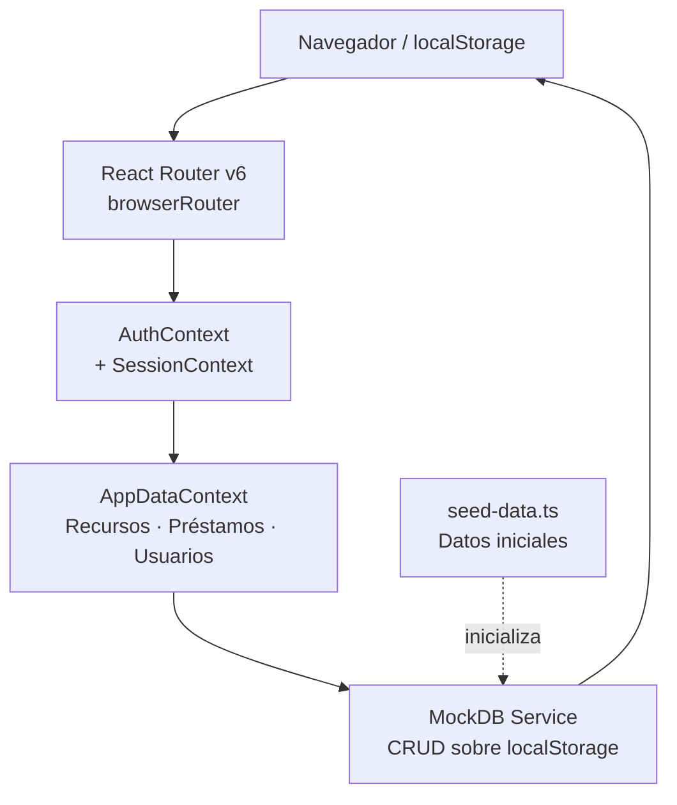
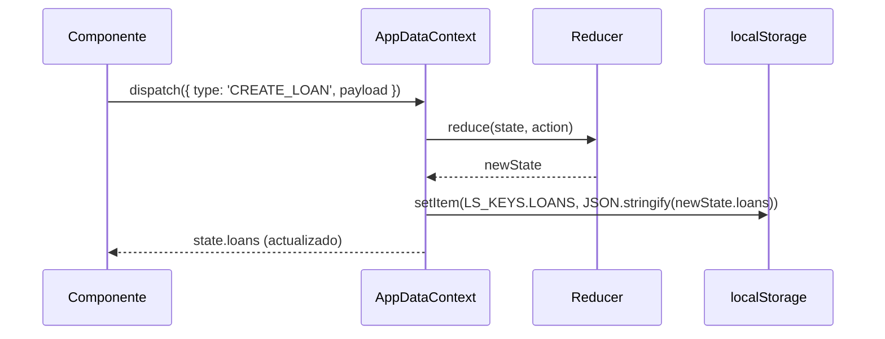
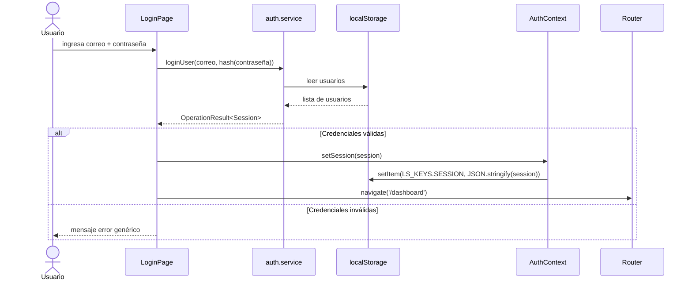
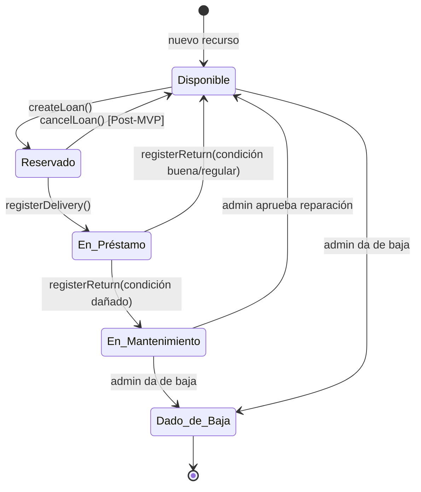

# Design Document

## Overview

El sistema es una Single-Page Application (SPA) construida con React 19 + TypeScript + Vite. No posee backend real: toda la persistencia se realiza en `localStorage` del navegador, y los datos iniciales se cargan desde un módulo de mock data. El sistema soporta tres roles con permisos diferenciados: **Estudiante**, **Técnico_Laboratorio** y **Administrador_Laboratorio**.

El MVP cubre el ciclo completo de préstamo: autenticación → consulta de disponibilidad → solicitud de préstamo → entrega → devolución con cálculo de retraso. Las funcionalidades Post-MVP (recuperación de contraseña, 2FA, CSV, calendario, notificaciones, reservas recurrentes, cancelación, reportes y sanciones) están diseñadas para incorporarse sin romper la arquitectura base.

**Decisiones clave de diseño:**
- **Sin backend real**: React Context + `localStorage` simulan la capa de datos.
- **Arquitectura orientada a features**: cada dominio (auth, inventory, loans, users) es un slice autocontenido.
- **Routing declarativo con guardias de rol**: React Router v6 con componentes `PrivateRoute` y `RoleGuard`.
- **Property-Based Testing con fast-check**: las propiedades de correctness se validan con generadores aleatorios usando `fast-check` + `Vitest`.

---

## Architecture

La aplicación se organiza en cuatro capas horizontales:

```
┌─────────────────────────────────────────────────────────────┐
│                        CAPA DE VISTAS (Pages)               │
│   LoginPage  │ InventoryPage │ LoansPage │ DashboardPage … │
├─────────────────────────────────────────────────────────────┤
│                     CAPA DE FEATURES                         │
│   auth/  │  inventory/  │  loans/  │  users/  │  reports/  │
├─────────────────────────────────────────────────────────────┤
│                  CAPA DE INFRAESTRUCTURA                     │
│  services/mockDb  │  contexts/  │  hooks/  │  router/      │
├─────────────────────────────────────────────────────────────┤
│                   CAPA COMPARTIDA (shared)                   │
│    components/  │  types/  │  utils/  │  constants/        │
└─────────────────────────────────────────────────────────────┘
```

### Diagrama de arquitectura de alto nivel



---

## Components and Interfaces

### Diagrama de componentes

```mermaid
graph LR
    subgraph Router["Router (react-router-dom v6)"]
        PublicRoutes["Rutas públicas\n/login · /register"]
        PrivateRoute["PrivateRoute\n(requiere sesión)"]
        RoleGuard["RoleGuard\n(requiere rol)"]
    end

    subgraph Layouts
        AppShell["AppShell\nHeader + Sidebar + Breadcrumbs"]
        AuthLayout["AuthLayout\nCentrado · Sin nav"]
    end

    subgraph Pages
        LoginPage
        RegisterPage
        DashboardPage
        AvailabilityPage
        LoanFormPage
        MyLoansPage
        DeliveryPage
        ReturnPage
        InventoryPage
        ResourceFormPage
        AccessDeniedPage
    end

    subgraph SharedComponents["Componentes compartidos"]
        Button
        Input
        Select
        Modal
        Toast["Toast / Notification"]
        SkeletonLoader
        Breadcrumb
        StatusBadge
    end

    subgraph FeatureComponents["Componentes de feature"]
        ResourceCard
        ResourceForm
        LoanCard
        LoanForm
        DeliveryForm
        ReturnForm
        InventoryTable
    end

    PublicRoutes --> AuthLayout
    PrivateRoute --> AppShell
    RoleGuard --> Pages
    AppShell --> Pages
    Pages --> FeatureComponents
    Pages --> SharedComponents
    FeatureComponents --> SharedComponents
```



### Interfaces de props principales

| Componente | Props clave |
|---|---|
| `PrivateRoute` | `children: ReactNode` |
| `RoleGuard` | `allowedRoles: UserRole[]`, `children: ReactNode` |
| `ResourceCard` | `resource: Resource`, `onRequestLoan?: () => void` |
| `LoanForm` | `resourceId: string`, `onSubmit: (data: LoanFormData) => void` |
| `StatusBadge` | `status: ResourceStatus \| LoanStatus` |
| `Toast` | `type: 'success'\|'error'\|'info'`, `message: string`, `onClose: () => void` |

---

## Data Models

```typescript
// ─── Roles ───────────────────────────────────────────────────────────────────
export type UserRole = 'Estudiante' | 'Técnico_Laboratorio' | 'Administrador_Laboratorio';

// ─── Usuario ─────────────────────────────────────────────────────────────────
export interface User {
  idUsuario: string;          // UUID v4
  idRol: UserRole;
  nombre: string;
  correo: string;
  cedula: string;
  carnet?: string;            // solo Estudiante
  contrasena: string;         // hash bcrypt simulado (SHA-256 en mock)
  fechaRegistro: string;      // ISO 8601
  sanctionEndDate?: string;   // ISO 8601 — Post-MVP
}

// ─── Estado de Recurso ───────────────────────────────────────────────────────
export type ResourceStatus =
  | 'Disponible'
  | 'Reservado'
  | 'En_Préstamo'
  | 'En_Mantenimiento'
  | 'Dado_de_Baja';

// ─── Recurso ─────────────────────────────────────────────────────────────────
export type ResourceType = 'Equipo' | 'Herramienta' | 'Material';

export interface Resource {
  idRecurso: string;          // UUID v4
  nombre: string;             // max 100 chars
  codigoInventario: string;
  tipo: ResourceType;
  descripcion: string;
  imagenUrl?: string;
  cantidadTotal: number;      // entero > 0
  cantidadDisponible: number; // 0..cantidadTotal
  estadoActual: ResourceStatus;
  fechaCreacion: string;      // ISO 8601
}

// ─── Historial de estado de recurso ──────────────────────────────────────────
export interface ResourceStatusHistory {
  idEstado: string;
  idRecurso: string;
  estado: ResourceStatus;
  fechaCambio: string;        // ISO 8601
  motivo?: string;
}

// ─── Estado de Préstamo ──────────────────────────────────────────────────────
export type LoanStatus =
  | 'Reservado'
  | 'En_Préstamo'
  | 'Devuelto'
  | 'Cancelado'
  | 'Vencido';

// ─── Condición de recurso al registrar entrega/devolución ────────────────────
export type ResourceCondition = 'Bueno' | 'Regular' | 'Dañado';

// ─── Préstamo ─────────────────────────────────────────────────────────────────
export interface Loan {
  idPrestamo: string;         // UUID v4
  idUsuario: string;
  idRecurso: string;
  fechaHoraReserva: string;   // ISO 8601 — cuando se creó la reserva
  fechaHoraInicioProgramada: string;  // ISO 8601 — inicio solicitado
  fechaHoraFinProgramada: string;     // ISO 8601 — fin solicitado
  fechaHoraEntrega?: string;  // ISO 8601 — registrada por Técnico
  fechaHoraDevolucionReal?: string;   // ISO 8601 — registrada por Técnico
  estadoPrestamo: LoanStatus;
  motivoPrestamo: string;     // 10..500 chars
  condicionEntrega?: ResourceCondition;
  condicionDevolucion?: ResourceCondition;
  observacionesEntrega?: string;
  observacionesDevolucion?: string;
  retrasoHoras?: number;      // calculado: max(0, devReal - finProgramada) en horas
}

// ─── Sanción (Post-MVP) ───────────────────────────────────────────────────────
export type SanctionStatus = 'Activa' | 'Expirada';

export interface Sanction {
  idSancion: string;
  idUsuario: string;
  idPrestamo: string;
  fechaInicio: string;        // ISO 8601
  fechaFin: string;           // ISO 8601
  motivo: string;
  estado: SanctionStatus;
}

// ─── Sesión simulada ──────────────────────────────────────────────────────────
export interface Session {
  userId: string;
  role: UserRole;
  nombre: string;
  correo: string;
  expiresAt: string;          // ISO 8601
}

// ─── Formulario de préstamo ───────────────────────────────────────────────────
export interface LoanFormData {
  idRecurso: string;
  fechaHoraInicioProgramada: string;
  fechaHoraFinProgramada: string;
  motivoPrestamo: string;
}

// ─── Resultado de operación ───────────────────────────────────────────────────
export interface OperationResult<T = void> {
  success: boolean;
  data?: T;
  error?: string;
}

// ─── Namespace localStorage ───────────────────────────────────────────────────
export const LS_KEYS = {
  USERS: 'sistema-prestamos-lab-users',
  RESOURCES: 'sistema-prestamos-lab-resources',
  LOANS: 'sistema-prestamos-lab-loans',
  STATUS_HISTORY: 'sistema-prestamos-lab-status-history',
  SANCTIONS: 'sistema-prestamos-lab-sanctions',
  SESSION: 'sistema-prestamos-lab-session',
  INITIALIZED: 'sistema-prestamos-lab-initialized',
} as const;
```

---

## State Management

### Contextos globales

Se usan **dos contextos separados** para evitar re-renders innecesarios:

```
AuthContext          → sesión activa (user, role, login, logout)
AppDataContext       → datos de dominio (resources, loans, users, sanctions)
UIContext             → estado UI transversal (toasts, loading global)
```

#### Patrón Context + useReducer

Cada contexto sigue el patrón `useReducer` + `localStorage sync`:

```
Dispatch(Action)
      │
      ▼
  Reducer (puro)  →  nuevo estado
      │
      ▼
  useEffect       →  localStorage.setItem(key, JSON.stringify(state))
```

El estado inicial se carga al montar desde `localStorage`. Si la clave no existe, se ejecuta `seedData()` que carga los datos de ejemplo predefinidos.

#### Modelo de flujo de datos



### Persistencia

- Namespace único: prefijo `sistema-prestamos-lab-`
- Serialización: `JSON.stringify` / `JSON.parse`
- Validación al cargar: schema check contra tipos TypeScript (Zod o validación manual)
- Reset de datos: función `resetToSeed()` disponible en DevTools panel

---

## Routing Strategy

### Estructura de rutas

```
/                         → redirige a /dashboard o /login
/login                    → LoginPage (público)
/register                 → RegisterPage (público)

── Requiere sesión activa (PrivateRoute) ─────────────────────────────────────
/dashboard                → DashboardPage (todos los roles)
/availability             → AvailabilityPage (todos los roles)

── Solo Estudiante ───────────────────────────────────────────────────────────
/loans/new/:resourceId    → LoanFormPage
/loans/my                 → MyLoansPage

── Solo Técnico_Laboratorio ─────────────────────────────────────────────────
/deliveries               → DeliveryPage (entregas pendientes)
/returns                  → ReturnPage (devoluciones pendientes)

── Solo Administrador_Laboratorio ───────────────────────────────────────────
/inventory                → InventoryPage
/inventory/new            → ResourceFormPage (crear)
/inventory/:id/edit       → ResourceFormPage (editar)
/sanctions                → SanctionsPage (Post-MVP)
/reports                  → ReportsPage (Post-MVP)

── Utilidad ──────────────────────────────────────────────────────────────────
/access-denied            → AccessDeniedPage
*                         → NotFoundPage
```

### Componentes de guardia

```typescript
// PrivateRoute: redirige a /login si no hay sesión
function PrivateRoute({ children }: { children: ReactNode }) {
  const { session } = useAuth();
  return session ? <>{children}</> : <Navigate to="/login" replace />;
}

// RoleGuard: redirige a /access-denied si el rol no está permitido
function RoleGuard({ allowedRoles, children }: RoleGuardProps) {
  const { session } = useAuth();
  if (!session || !allowedRoles.includes(session.role)) {
    return <Navigate to="/access-denied" replace />;
  }
  return <>{children}</>;
}
```

---

## Mock Services Layer

El módulo `services/mockDb` expone funciones CRUD puras que leen y escriben en `localStorage`. Son síncronas para mantener la API simple, dado que no hay llamadas de red.

### Estructura del módulo

```
src/services/mockDb/
├── index.ts              // re-exports
├── auth.service.ts       // register, login, logout
├── resources.service.ts  // CRUD de recursos
├── loans.service.ts      // CRUD de préstamos + entrega + devolución
├── users.service.ts      // CRUD de usuarios
├── sanctions.service.ts  // CRUD de sanciones (Post-MVP)
└── seed-data.ts          // datos iniciales
```

### Contratos principales

```typescript
// auth.service.ts
export function registerUser(data: RegisterFormData): OperationResult<User>
export function loginUser(correo: string, contrasena: string): OperationResult<Session>
export function logoutUser(): void

// resources.service.ts
export function getResources(filters?: ResourceFilters): Resource[]
export function getResourceById(id: string): Resource | undefined
export function createResource(data: CreateResourceData): OperationResult<Resource>
export function updateResource(id: string, data: Partial<Resource>): OperationResult<Resource>
export function retireResource(id: string): OperationResult<void>
export function updateResourceStatus(id: string, newStatus: ResourceStatus, motivo?: string): OperationResult<void>

// loans.service.ts
export function createLoan(data: LoanFormData, userId: string): OperationResult<Loan>
export function getLoansByUser(userId: string): Loan[]
export function getPendingDeliveries(): Loan[]
export function getPendingReturns(): Loan[]
export function registerDelivery(loanId: string, data: DeliveryData): OperationResult<Loan>
export function registerReturn(loanId: string, data: ReturnData): OperationResult<Loan>
export function checkAvailability(resourceId: string, start: string, end: string): boolean
```

### Validaciones en servicios

Las funciones de servicio realizan validaciones de negocio antes de persistir:
- `createLoan`: verifica solapamiento de horarios, que `hora_fin > hora_inicio + 1h`, duración ≤ 24h, motivo 10–500 chars.
- `registerReturn`: calcula `retrasoHoras = max(0, devReal - finProgramada)` y determina si el nuevo estado del recurso es `Disponible` o `En_Mantenimiento`.
- `retireResource`: rechaza si el recurso tiene préstamos con estado `Reservado` o `En_Préstamo`.

---

## Authentication Flow



El token de sesión es un objeto `Session` serializado en `localStorage`. Al iniciar la app, `AuthContext` lo lee y restaura el estado. La expiración se valida comparando `session.expiresAt` con la fecha actual.

---

## Design Patterns

| Patrón | Aplicación |
|---|---|
| **Context + useReducer** | Estado global de auth y datos de dominio |
| **Custom Hooks** | `useAuth()`, `useResources()`, `useLoans()`, `useToast()` — encapsulan lógica de contexto |
| **Compound Components** | `Modal.Header`, `Modal.Body`, `Modal.Footer` |
| **Render Props / Slot pattern** | `AppShell` acepta `sidebar` y `header` como props |
| **Strategy** | `validators.ts` exporta funciones validadoras intercambiables por campo |
| **Repository** | `mockDb` actúa como repositorio: aisla la lógica de acceso a datos de los componentes |
| **Facade** | Los custom hooks son fachadas sobre el contexto y los servicios |
| **Guard Pattern** | `PrivateRoute` y `RoleGuard` como componentes de guardia declarativos |

---

## Folder Structure

```
src/
├── app/
│   ├── router.tsx              # createBrowserRouter con todas las rutas
│   ├── providers.tsx           # composición de contextos (AuthProvider > AppDataProvider > UIProvider)
│   └── App.tsx
│
├── features/
│   ├── auth/
│   │   ├── components/         # LoginForm, RegisterForm
│   │   ├── hooks/              # useLoginForm, useRegisterForm
│   │   ├── pages/              # LoginPage, RegisterPage
│   │   └── types.ts
│   ├── inventory/
│   │   ├── components/         # InventoryTable, ResourceForm, ResourceCard
│   │   ├── hooks/              # useInventory
│   │   ├── pages/              # InventoryPage, ResourceFormPage
│   │   └── types.ts
│   ├── loans/
│   │   ├── components/         # LoanForm, LoanCard, MyLoansList
│   │   ├── hooks/              # useLoans, useAvailability
│   │   ├── pages/              # AvailabilityPage, LoanFormPage, MyLoansPage
│   │   └── types.ts
│   ├── operations/             # entregas y devoluciones (Técnico)
│   │   ├── components/         # DeliveryForm, ReturnForm
│   │   ├── hooks/              # useDeliveries, useReturns
│   │   ├── pages/              # DeliveryPage, ReturnPage
│   │   └── types.ts
│   └── dashboard/
│       └── pages/              # DashboardPage (por rol)
│
├── shared/
│   ├── components/
│   │   ├── ui/                 # Button, Input, Select, Modal, Toast, SkeletonLoader
│   │   ├── layout/             # AppShell, AuthLayout, Breadcrumb, Sidebar
│   │   └── guards/             # PrivateRoute, RoleGuard
│   ├── hooks/                  # useLocalStorage, useForm, useDebounce
│   ├── types/                  # types globales (index.ts re-exporta todo)
│   ├── utils/
│   │   ├── validators.ts       # funciones de validación puras
│   │   ├── dateUtils.ts        # formateo y cálculo de fechas
│   │   ├── hashUtils.ts        # hash simulado de contraseñas
│   │   └── uuidUtils.ts        # generación de UUIDs
│   └── constants/
│       └── lsKeys.ts           # LS_KEYS
│
├── services/
│   └── mockDb/
│       ├── auth.service.ts
│       ├── resources.service.ts
│       ├── loans.service.ts
│       ├── users.service.ts
│       ├── sanctions.service.ts
│       ├── seed-data.ts
│       └── index.ts
│
└── contexts/
    ├── AuthContext.tsx
    ├── AppDataContext.tsx
    └── UIContext.tsx
```

---

## Error Handling

### Estrategia por capa

| Capa | Estrategia |
|---|---|
| **Servicios** | Retornan `OperationResult<T>` — nunca lanzan excepciones no controladas |
| **Contextos** | Capturan errores de servicios y los propagan al UIContext como toast de error |
| **Componentes** | `ErrorBoundary` en el nivel de página para errores de renderizado inesperados |
| **Formularios** | Errores de validación mostrados inline debajo del campo con `aria-live="polite"` |
| **localStorage** | Wrap en `try/catch`; si falla se muestra mensaje de error bloqueante |

### Mensajes de error

Los mensajes son descriptivos, en español, sin revelar detalles técnicos. Ejemplos:
- Credenciales inválidas: `"Correo o contraseña incorrectos."`
- Solapamiento de horario: `"El recurso no está disponible en el horario seleccionado."`
- Recurso dado de baja: `"No se puede realizar la acción porque el recurso tiene préstamos activos."`

---

## Testing Strategy

### Enfoque dual

La estrategia combina **tests de ejemplo** (unit/integration) con **tests basados en propiedades** (PBT) usando [fast-check](https://fast-check.dev/) + [Vitest](https://vitest.dev/).

**Tests de ejemplo (Vitest)**:
- Validaciones de formularios con casos concretos
- Flujos de autenticación con credenciales específicas
- Transiciones de estado de recurso con secuencias predefinidas
- Renderizado de componentes con `@testing-library/react`

**Tests de propiedades (fast-check + Vitest)**:
- Mínimo 100 iteraciones por propiedad
- Cada test lleva un comentario con tag: `// Feature: frontend-sistema-prestamos-laboratorio, Property N: <texto>`
- Testean las funciones puras de `services/mockDb` y `utils/`

**Distribución por capa:**

```
src/
├── __tests__/
│   ├── properties/        # fast-check property tests
│   │   ├── loans.property.test.ts
│   │   ├── resources.property.test.ts
│   │   ├── validators.property.test.ts
│   │   └── serialization.property.test.ts
│   └── unit/              # tests de ejemplo
│       ├── auth.test.ts
│       ├── loanService.test.ts
│       └── resourceService.test.ts
```

**PBT es apropiado** para este feature porque las funciones de servicio (`createLoan`, `checkAvailability`, `registerReturn`, `validatePassword`, serialización JSON) son funciones puras con espacio de entrada amplio donde 100 iteraciones revelan más bugs que 2-3 ejemplos.

**PBT no aplica** a:
- Renderizado de componentes React (usar snapshot tests)
- Navegación y guardias de router (usar tests de ejemplo)
- localStorage directamente (usar tests de integración con 2-3 ejemplos)


---

## Correctness Properties

*Una propiedad es una característica o comportamiento que debe ser verdadero en todas las ejecuciones válidas del sistema — esencialmente, una afirmación formal sobre lo que el sistema debe hacer. Las propiedades sirven de puente entre las especificaciones legibles por humanos y las garantías de correctness verificables automáticamente.*

Las propiedades de abajo se implementan con **[fast-check](https://fast-check.dev/)** + **Vitest**, con mínimo 100 iteraciones cada una. Todas testean funciones puras de la capa de servicios (`mockDb`) o utilidades (`utils/`), sin dependencias de red ni de localStorage real.

### Propiedad 1: Validación de contraseña

*Para toda* cadena de texto `s`, la función `validatePassword(s)` debe retornar `true` si y solo si `s` tiene al menos 8 caracteres, contiene al menos una mayúscula, al menos una minúscula y al menos un dígito numérico.

**Validates: Requirements 1.4**

---

### Propiedad 2: Contraseñas distintas son rechazadas

*Para todo* par de cadenas `(a, b)` donde `a !== b`, la función `passwordsMatch(a, b)` debe retornar `false`.

**Validates: Requirements 1.5**

---

### Propiedad 3: Error de login es genérico para credenciales inválidas

*Para toda* combinación `(correo, contraseña)` que no corresponda a un usuario registrado, `loginUser(correo, contraseña)` debe retornar un `OperationResult` con `success: false` y un mensaje de error idéntico sin distinguir si el correo o la contraseña son incorrectos.

**Validates: Requirements 1.8**

---

### Propiedad 4: Filtrado de recursos es un subconjunto con coincidencia exacta

*Para toda* lista de recursos `R` y todo texto de búsqueda `t`, `filterByName(R, t)` debe retornar una lista donde cada elemento tiene su `nombre` conteniendo `t` (ignorando mayúsculas) y cuya longitud es menor o igual a `R.length`.

**Validates: Requirements 6.4, 6.11**

---

### Propiedad 5: Verificación de disponibilidad excluye solapamientos

*Para todo* rango de tiempo `(inicio, fin)` y toda lista de préstamos activos, ningún recurso retornado por `getAvailableResources(inicio, fin)` debe tener un préstamo con estado `Reservado` o `En_Préstamo` cuyo intervalo `[fechaHoraInicioProgramada, fechaHoraFinProgramada]` se solape con `(inicio, fin)`.

**Validates: Requirements 6.8, 8.8**

---

### Propiedad 6: Validación de tiempos de préstamo

*Para todo* par `(inicio, fin)`, `validateLoanTimes(inicio, fin)` debe retornar `false` si: `inicio` es anterior a la fecha actual, o `fin - inicio < 1 hora`, o `fin - inicio > 24 horas`.

**Validates: Requirements 8.3, 8.4, 8.5**

---

### Propiedad 7: Creación de préstamo válido produce estado "Reservado"

*Para todo* `LoanFormData` válido (fechas válidas, motivo entre 10-500 chars, recurso disponible, sin solapamiento), `createLoan(data, userId)` debe retornar un `Loan` con `estadoPrestamo === 'Reservado'`.

**Validates: Requirements 8.7, 22.2**

---

### Propiedad 8: Cálculo de retraso es correcto y no negativo

*Para todo* par `(fechaDevolucionReal, fechaFinProgramada)`, el retraso calculado debe ser `max(0, diferenciaEnHoras(devReal, finProgramada))`. Si `devReal <= finProgramada`, el retraso es 0.

**Validates: Requirements 13.5, 13.11**

---

### Propiedad 9: Devolución en condición "Dañado" transiciona a "En_Mantenimiento"

*Para todo* préstamo activo y cualquier devolución donde `condicionDevolucion === 'Dañado'`, el recurso asociado debe quedar con `estadoActual === 'En_Mantenimiento'` y no `'Disponible'`.

**Validates: Requirements 13.9, 22.5**

---

### Propiedad 10: Transiciones de estado inválidas son rechazadas

*Para todo* par `(estadoActual, nuevoEstado)` que no pertenezca a la tabla de transiciones válidas (ver diagrama de máquina de estados), `updateResourceStatus(id, nuevoEstado)` debe retornar `OperationResult` con `success: false`.

Transiciones válidas:
- `Disponible` → `Reservado` (al crear préstamo)
- `Reservado` → `En_Préstamo` (al registrar entrega)
- `Reservado` → `Cancelado` (al cancelar reserva — Post-MVP)
- `En_Préstamo` → `Disponible` (devolución en buen/regular estado)
- `En_Préstamo` → `En_Mantenimiento` (devolución dañado)
- `En_Mantenimiento` → `Disponible` (admin aprueba)
- `En_Mantenimiento` → `Dado_de_Baja` (admin da de baja)
- `Disponible` → `Dado_de_Baja` (admin da de baja)

**Validates: Requirements 22.8**

---

### Propiedad 11: Serialización round-trip de entidades de dominio

*Para todo* objeto válido de tipo `Resource`, `User` o `Loan`, `JSON.parse(JSON.stringify(obj))` debe producir un objeto estructuralmente equivalente al original (mismas claves y valores).

**Validates: Requirements 23.5, 23.6**

---

## Resource State Machine


