# Diagramas del Entregable 2

Proyecto: Sistema de préstamo de recursos de laboratorio.
Curso: Diseño de Sistemas de Información (ITM). Docente: Alejandra Guerrero Bocanegra. Estudiante: Victor Alejandro Aristizabal Ospina.

Esta carpeta contiene los diagramas de la **Sección 2 (Arquitectura C4)** y de la **Sección 5 (Diagramas de actividades del MVP)** del Entregable 2. Son 10 archivos `.drawio` y 11 imágenes PNG, porque `c4-4-codigo.drawio` tiene dos páginas. Todos describen el código real de `sistemas-informacion/src/` en la rama `main`, no un diseño ideal.

Cada diagrama tiene tres cosas que pide la guía del entregable: imagen, enlace editable y explicación breve. La sección 2 de este documento trae un bloque por diagrama para copiar al informe. La sección 3 explica cómo conseguir el enlace editable, que **todavía hay que generar**: en este repositorio no hay ninguna URL pública de los diagramas.

## 1. Índice

| # | Diagrama | Nivel C4 o historia | Archivo `.drawio` | Imagen |
|---|---|---|---|---|
| 1 | Contexto | C4 nivel 1 | `c4-1-contexto.drawio` | `img/c4-1-contexto.png` |
| 2 | Contenedores | C4 nivel 2 | `c4-2-contenedores.drawio` | `img/c4-2-contenedores.png` |
| 3 | Componentes | C4 nivel 3 | `c4-3-componentes.drawio` | `img/c4-3-componentes.png` |
| 4 | Código: dominio (página 4a) | C4 nivel 4 | `c4-4-codigo.drawio` (página «Nivel 4a - Dominio») | `img/c4-4-codigo-4a-dominio.png` |
| 5 | Código: persistencia y comportamiento (página 4b) | C4 nivel 4 | `c4-4-codigo.drawio` (página «Nivel 4b - Persistencia y comportamiento») | `img/c4-4-codigo-4b-persistencia.png` |
| 6 | Actividad HU-01 Registro de nuevo usuario | HU-01 | `actividad-hu-01-registro.drawio` | `img/actividad-hu-01-registro.png` |
| 7 | Actividad HU-02 Inicio de sesión | HU-02 | `actividad-hu-02-inicio-sesion.drawio` | `img/actividad-hu-02-inicio-sesion.png` |
| 8 | Actividad HU-03 Consultar disponibilidad | HU-03 | `actividad-hu-03-consultar-disponibilidad.drawio` | `img/actividad-hu-03-consultar-disponibilidad.png` |
| 9 | Actividad HU-04 Solicitar préstamo | HU-04 | `actividad-hu-04-solicitar-prestamo.drawio` | `img/actividad-hu-04-solicitar-prestamo.png` |
| 10 | Actividad HU-05 Gestión de inventario | HU-05 | `actividad-hu-05-gestion-inventario.drawio` | `img/actividad-hu-05-gestion-inventario.png` |
| 11 | Actividad HU-06 Registrar entrega y devolución | HU-06 | `actividad-hu-06-entrega-devolucion.drawio` | `img/actividad-hu-06-entrega-devolucion.png` |

Las rutas de la tabla son relativas a `docs/diagramas/`. Las 11 imágenes existen y están versionadas (se exportaron con draw.io Desktop a escala 2, fondo blanco; ver sección 4).

### Trazabilidad con el Entregable 1

Las historias **HU-01 a HU-06** se corresponden una a una con los requisitos de usuario **RU-01 a RU-06**: coinciden los títulos y la matriz de trazabilidad (sección 7) del archivo `Entregable 1 10%.md`. Los requisitos funcionales **no** se corresponden uno a uno con las historias en ese documento. Su matriz de trazabilidad dice:

| Requisito de usuario / historia | Requisitos funcionales (matriz del E1) | Reglas de negocio (matriz del E1) |
|---|---|---|
| RU-01 / HU-01 Registro | RF-01 | - |
| RU-02 / HU-02 Inicio de sesión | RF-01 (validación) | RN-01 |
| RU-03 / HU-03 Consultar disponibilidad | RF-05 | RN-02, RN-05 |
| RU-04 / HU-04 Solicitar préstamo | RF-05 (validación) | RN-03, RN-05 |
| RU-05 / HU-05 Gestionar inventario | RF-03, RF-04 | RN-02 |
| RU-06 / HU-06 Entrega y devolución | RF-06 | RN-04 |

RF-02 (asignación de roles por el Administrador) no aparece en ninguna fila de esa matriz. Los bloques de la sección 2 usan estas relaciones. El dossier de la tarea describía el mapeo RF a HU como «uno a uno»; eso se tomó del dossier y no coincide con la matriz del E1, por eso aquí se sigue la matriz.

## 2. Bloques para pegar en el entregable

En cada bloque, el marcador `<URL_CRUDA_DEL_ARCHIVO>` de «Enlace editable» se reemplaza siguiendo la sección 3. Para el PDF, las imágenes se insertan desde `docs/diagramas/img/`. Los nombres de archivo del código (`loans.service.ts` y similares) están en `sistemas-informacion/src/`.

---

### 2.1 Nivel 1: Contexto

- **Nombre:** [Nivel 1] Contexto: Sistema de préstamo de recursos de laboratorio
- **Nivel / historia:** C4 nivel 1 (sección 2 del entregable)
- **Archivo editable:** `docs/diagramas/c4-1-contexto.drawio`
- **Imagen:** `docs/diagramas/img/c4-1-contexto.png`

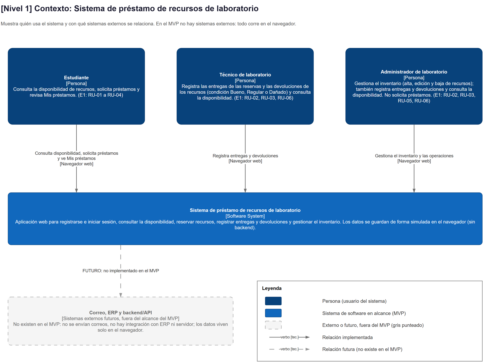

**Explicación:**
- Muestra quién usa el sistema: Estudiante, Técnico de laboratorio y Administrador de laboratorio, los tres roles del tipo `UserRole` en `shared/types/index.ts`.
- El sistema es una sola caja: una aplicación web cuyos datos se guardan de forma simulada en el navegador, sin backend.
- Correo, ERP y backend/API aparecen en gris punteado como sistemas externos futuros. No existen en el MVP.
- Trazabilidad con el E1: los actores y sus tareas vienen de RU-01 a RU-06 (Estudiante: RU-01 a RU-04; Técnico: RU-02, RU-03 y RU-06; Administrador: RU-02, RU-03, RU-05 y RU-06). El rol Docente del E1 no está en el código (ver sección 5).

**Enlace editable:** https://app.diagrams.net/?url=<URL_CRUDA_DEL_ARCHIVO c4-1-contexto.drawio>

---

### 2.2 Nivel 2: Contenedores

- **Nombre:** [Nivel 2] Contenedores: Sistema de préstamo de recursos de laboratorio
- **Nivel / historia:** C4 nivel 2 (sección 2 del entregable)
- **Archivo editable:** `docs/diagramas/c4-2-contenedores.drawio`
- **Imagen:** `docs/diagramas/img/c4-2-contenedores.png`

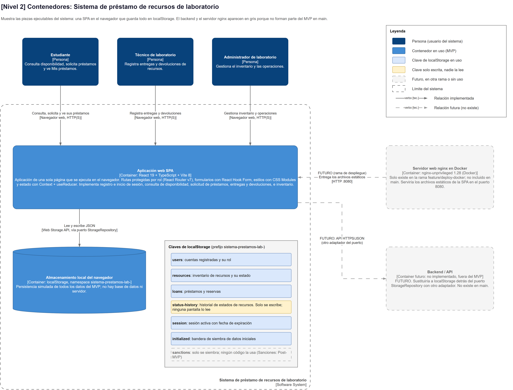

**Explicación:**
- Hay dos contenedores en uso: la aplicación SPA (React 19 + TypeScript + Vite 8, montada desde `main.tsx`) y el almacenamiento local del navegador (`localStorage`, prefijo `sistema-prestamos-lab-`).
- La SPA lee y escribe JSON a través del puerto `StorageRepository`. Las siete claves están en `shared/constants/lsKeys.ts`. De ellas, `status-history` solo se escribe (ninguna pantalla la lee) y `sanctions` solo se siembra vacía.
- El servidor nginx en Docker aparece en gris porque solo existe en la rama `feature/deploy-docker` (su `Dockerfile` usa `nginxinc/nginx-unprivileged:1.28-alpine` y expone el puerto 8080); `main` no lo contiene. El backend/API también es futuro.
- Trazabilidad con el E1: sustituye a la base de datos del E1. El RNF-04 (escalabilidad de la BD) no aplica porque no hay backend.

**Enlace editable:** https://app.diagrams.net/?url=<URL_CRUDA_DEL_ARCHIVO c4-2-contenedores.drawio>

---

### 2.3 Nivel 3: Componentes

- **Nombre:** [Nivel 3] Componentes: Aplicación web SPA
- **Nivel / historia:** C4 nivel 3 (sección 2 del entregable)
- **Archivo editable:** `docs/diagramas/c4-3-componentes.drawio`
- **Imagen:** `docs/diagramas/img/c4-3-componentes.png`

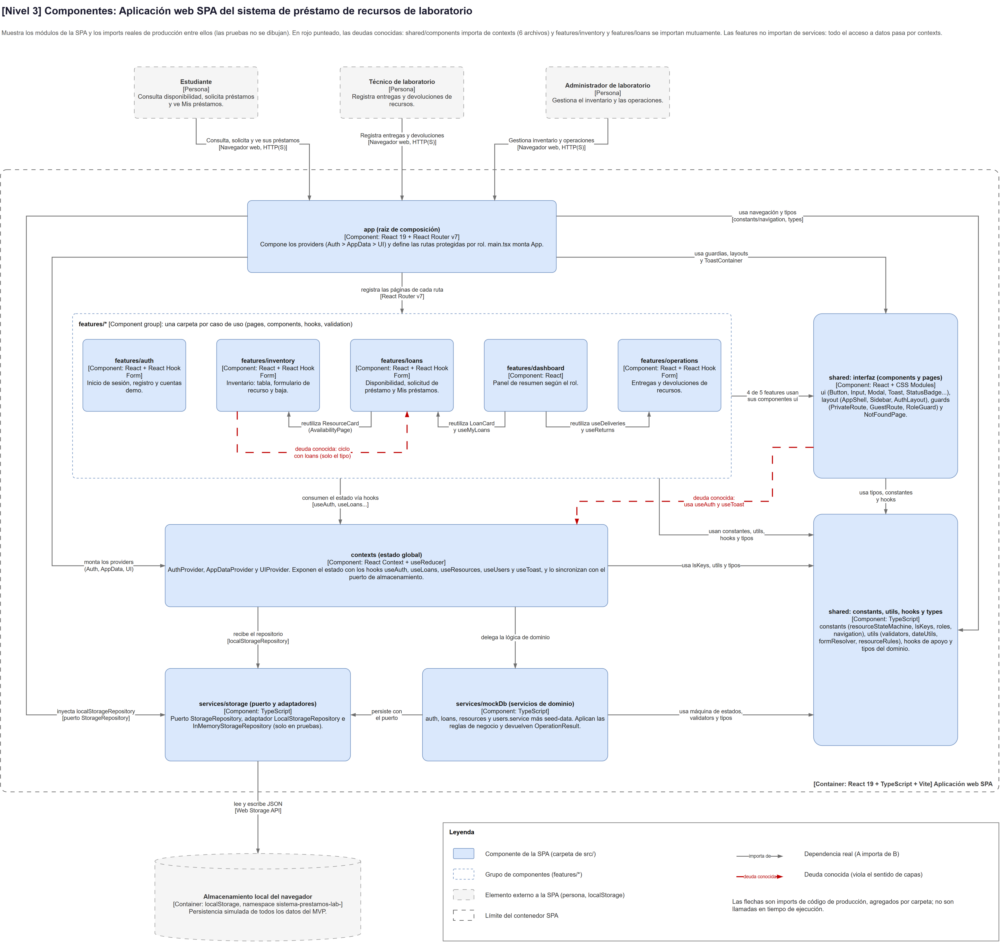

**Explicación:**
- Cada caja es una carpeta de `src/`: `app/` (raíz de composición: `App.tsx`, `providers.tsx`, `router.tsx`), `features/*` (`auth`, `inventory`, `loans`, `dashboard`, `operations`), `contexts/`, `services/mockDb`, `services/storage` y `shared/` (interfaz y núcleo).
- Las flechas son imports reales de código de producción, agregados por carpeta. Las features no importan de `services/`: acceden a los datos solo mediante los hooks de `contexts/` (`useAuth`, `useLoans`, `useResources`, `useUsers`, `useToast`).
- En rojo punteado están dos deudas conocidas: `shared/components` importa de `contexts` (6 archivos) y `features/inventory` y `features/loans` se importan entre sí.
- Trazabilidad con el E1: cada feature materializa una actividad del story mapping (cuenta, inventario, disponibilidad, préstamo, devolución); `features/operations` cubre RU-06/RF-06 y `features/inventory` cubre RU-05/RF-03.

**Enlace editable:** https://app.diagrams.net/?url=<URL_CRUDA_DEL_ARCHIVO c4-3-componentes.drawio>

---

### 2.4 Nivel 4a: Código, dominio

- **Nombre:** [Nivel 4] Código / Clases del dominio (página 4a)
- **Nivel / historia:** C4 nivel 4 (sección 2 del entregable)
- **Archivo editable:** `docs/diagramas/c4-4-codigo.drawio`, página «Nivel 4a - Dominio»
- **Imagen:** `docs/diagramas/img/c4-4-codigo-4a-dominio.png`

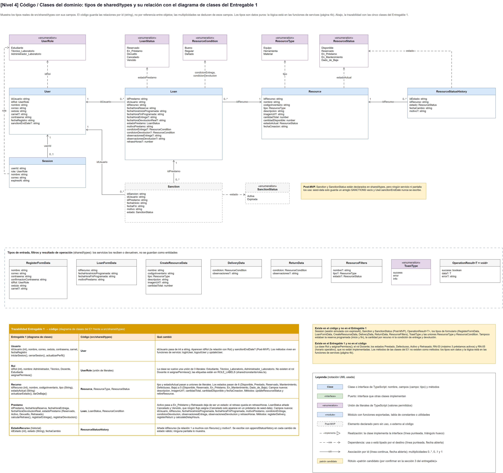

**Explicación:**
- Dibuja los tipos de `shared/types/index.ts`: `User`, `Loan`, `Resource`, `ResourceStatusHistory`, `Session`, las uniones `UserRole`, `LoanStatus`, `ResourceStatus`, `ResourceType` y `ResourceCondition`, y los tipos de formulario y de resultado (`OperationResult`).
- Las relaciones son por id (`idUsuario`, `idRecurso`, `idRol`), no por referencia entre objetos. Los tipos son datos puros; la lógica está en las funciones de `services/` (página 4b).
- Una tabla inferior relaciona las cinco clases del diagrama de clases del E1 (Usuario, Rol, Recurso, Prestamo, EstadoRecurso) con el tipo que las reemplaza y lo que cambió.
- `Sanction` y `SanctionStatus` están declarados pero ningún servicio ni pantalla los usa (Post-MVP).

**Enlace editable:** https://app.diagrams.net/?url=<URL_CRUDA_DEL_ARCHIVO c4-4-codigo.drawio> (el archivo abre en la página 4a; la 4b está en la pestaña inferior)

---

### 2.5 Nivel 4b: Código, persistencia y comportamiento

- **Nombre:** [Nivel 4] Código / Clases: persistencia y comportamiento (página 4b)
- **Nivel / historia:** C4 nivel 4 (sección 2 del entregable)
- **Archivo editable:** `docs/diagramas/c4-4-codigo.drawio`, página «Nivel 4b - Persistencia y comportamiento»
- **Imagen:** `docs/diagramas/img/c4-4-codigo-4b-persistencia.png`

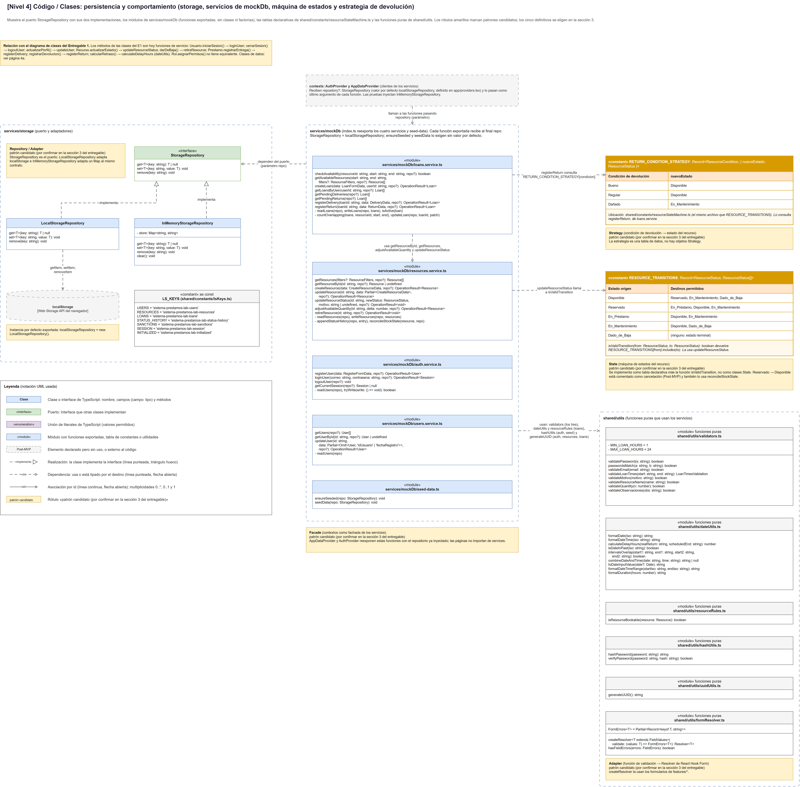

**Explicación:**
- Muestra el puerto `StorageRepository` (`get`, `set`, `remove`) con sus dos implementaciones, `LocalStorageRepository` e `InMemoryStorageRepository` (esta última se usa en pruebas), en `services/storage/`.
- Los servicios de `services/mockDb` (`auth`, `loans`, `resources`, `users` y `seed-data`) son módulos de funciones, no clases. Cada función exportada recibe `repo: StorageRepository` como último parámetro con `localStorageRepository` por defecto.
- Incluye las tablas declarativas `RESOURCE_TRANSITIONS` y `RETURN_CONDITION_STRATEGY` (`shared/constants/resourceStateMachine.ts`) y las funciones puras de `shared/utils` (`validators`, `dateUtils`, `resourceRules`, `formResolver`).
- Trazabilidad con el E1: los métodos de las clases del E1 son hoy funciones de servicio (`iniciarSesion` → `loginUser`, `darDeBaja` → `retireResource`, `registrarEntrega` → `registerDelivery`, `registrarDevolucion` → `registerReturn`, `actualizarEstado` → `updateResourceStatus`, `calcularRetraso` → `calculateDelayHours`).
- Los rótulos amarillos son **patrones candidatos** (ver sección 6).

**Enlace editable:** https://app.diagrams.net/?url=<URL_CRUDA_DEL_ARCHIVO c4-4-codigo.drawio> (mismo archivo que el bloque 2.4; seleccionar la pestaña «Nivel 4b - Persistencia y comportamiento»)

---

### 2.6 HU-01: Registro de nuevo usuario

- **Nombre:** HU-01 Registro de nuevo usuario
- **Nivel / historia:** Diagrama de actividades de HU-01 (RU-01, RF-01)
- **Archivo editable:** `docs/diagramas/actividad-hu-01-registro.drawio`
- **Imagen:** `docs/diagramas/img/actividad-hu-01-registro.png`

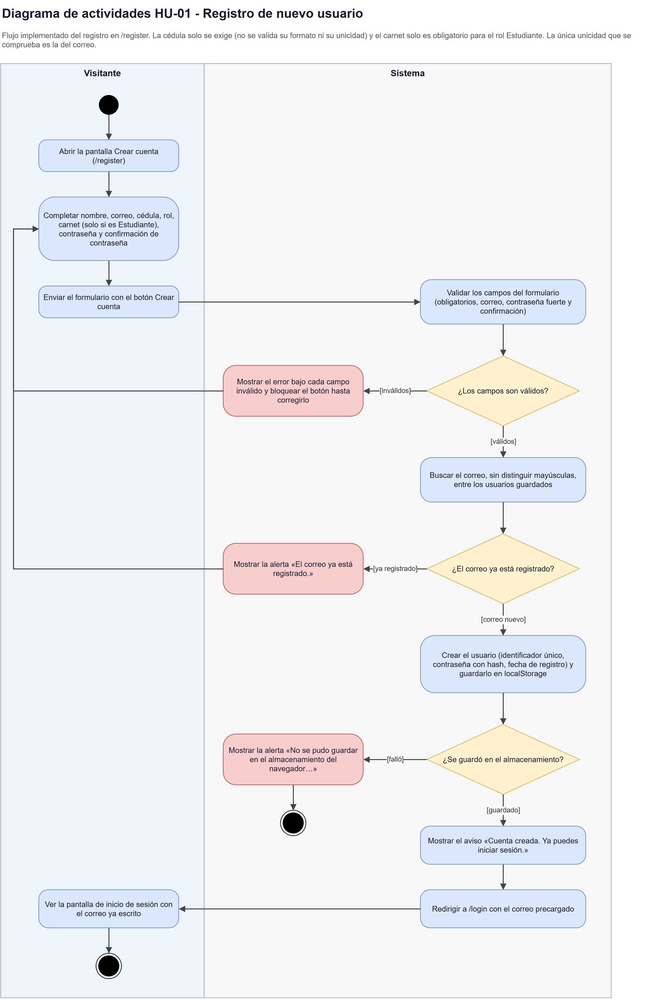

**Explicación:**
- Carriles Visitante y Sistema, sobre `/register`. El flujo principal es: completar el formulario, validar los campos, comprobar que el correo no exista, guardar el usuario con la contraseña en hash y redirigir a `/login` con el correo precargado.
- Las ramas de error son campos inválidos, correo ya registrado («El correo ya está registrado.») y fallo del almacenamiento.
- Código: `features/auth/` (`RegisterPage`, `RegisterForm`, `useRegisterForm`, `validation.ts`) y `registerUser` en `services/mockDb/auth.service.ts`.
- Diferencias con el E1: la cédula solo se exige, no se valida su formato ni su unicidad; el carnet es obligatorio solo para el rol Estudiante; el rol se elige en el formulario (por defecto Estudiante).

**Enlace editable:** https://app.diagrams.net/?url=<URL_CRUDA_DEL_ARCHIVO actividad-hu-01-registro.drawio>

---

### 2.7 HU-02: Inicio de sesión

- **Nombre:** HU-02 Inicio de sesión
- **Nivel / historia:** Diagrama de actividades de HU-02 (RU-02, RF-01 validación, RN-01)
- **Archivo editable:** `docs/diagramas/actividad-hu-02-inicio-sesion.drawio`
- **Imagen:** `docs/diagramas/img/actividad-hu-02-inicio-sesion.png`

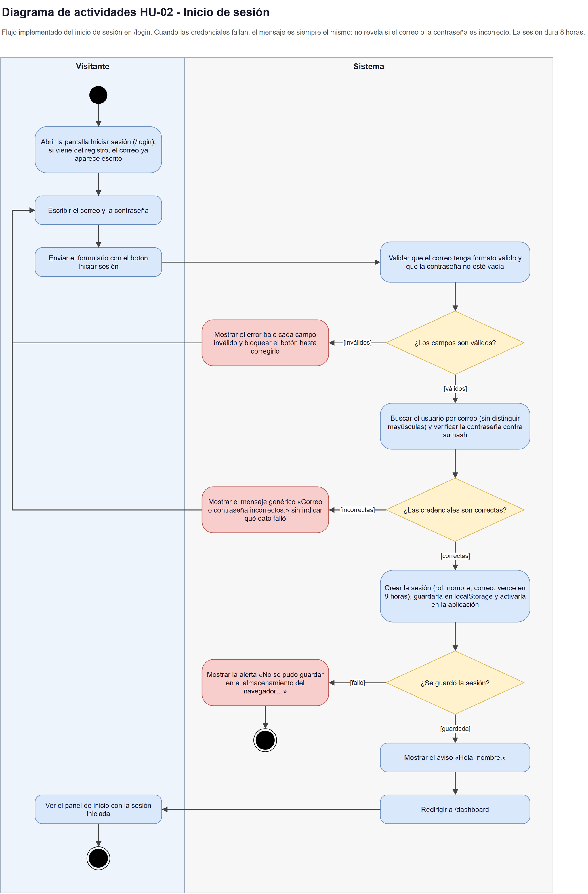

**Explicación:**
- Sobre `/login`: el sistema valida el formato del correo y que la contraseña no esté vacía, busca el usuario por correo (sin distinguir mayúsculas) y verifica la contraseña contra su hash.
- Si las credenciales fallan, el mensaje es siempre el mismo («Correo o contraseña incorrectos.»), sin revelar cuál dato falló. Si son correctas, se crea una sesión de 8 horas (`SESSION_DURATION_MS` en `auth.service.ts`), se guarda en `localStorage` y se redirige a `/dashboard`.
- Código: `features/auth/` (`LoginPage`, `LoginForm`, `useLoginForm`) y `loginUser` en `auth.service.ts`.
- Relación con RN-01: las rutas privadas usan `PrivateRoute` en `app/router.tsx`; solo `/login` y `/register` son públicas.
- Diferencia con el E1: el texto del error es otro («Usuario o contraseña inválidos» en el E1).

**Enlace editable:** https://app.diagrams.net/?url=<URL_CRUDA_DEL_ARCHIVO actividad-hu-02-inicio-sesion.drawio>

---

### 2.8 HU-03: Consultar disponibilidad

- **Nombre:** HU-03 Consultar disponibilidad
- **Nivel / historia:** Diagrama de actividades de HU-03 (RU-03, RF-05, RN-02)
- **Archivo editable:** `docs/diagramas/actividad-hu-03-consultar-disponibilidad.drawio`
- **Imagen:** `docs/diagramas/img/actividad-hu-03-consultar-disponibilidad.png`

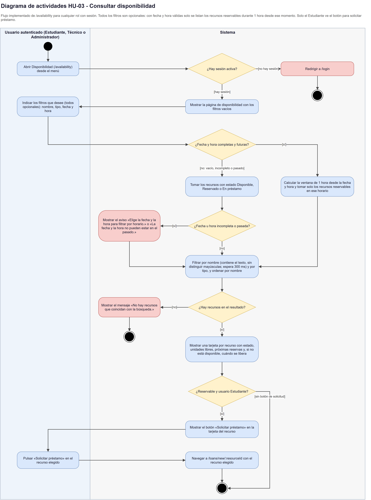

**Explicación:**
- Sobre `/availability`, para cualquier rol con sesión. Los filtros (nombre, tipo, fecha y hora) son opcionales. Con fecha y hora completas y futuras solo se listan los recursos reservables durante una hora desde ese momento (`AVAILABILITY_WINDOW_MS` en `features/loans/availability.ts`).
- Cada recurso se muestra en una tarjeta con su estado, unidades libres y, si no está disponible, cuándo se libera. Solo el Estudiante ve el botón «Solicitar préstamo», que lleva a `/loans/new/:resourceId`.
- Código: `AvailabilityPage`, `useAvailability` y `availability.ts` en `features/loans/`; `getAvailableResources` en `loans.service.ts`; `isResourceBookable` en `shared/utils/resourceRules.ts` (RN-02).
- Diferencia con el E1: en lugar de elegir un recurso y mostrar «Libre»/«Ocupado», el código lista los recursos con filtros y marca como «No disponible» los que no se pueden reservar.

**Enlace editable:** https://app.diagrams.net/?url=<URL_CRUDA_DEL_ARCHIVO actividad-hu-03-consultar-disponibilidad.drawio>

---

### 2.9 HU-04: Solicitar préstamo

- **Nombre:** HU-04 Solicitar préstamo
- **Nivel / historia:** Diagrama de actividades de HU-04 (RU-04, RF-05 validación)
- **Archivo editable:** `docs/diagramas/actividad-hu-04-solicitar-prestamo.drawio`
- **Imagen:** `docs/diagramas/img/actividad-hu-04-solicitar-prestamo.png`

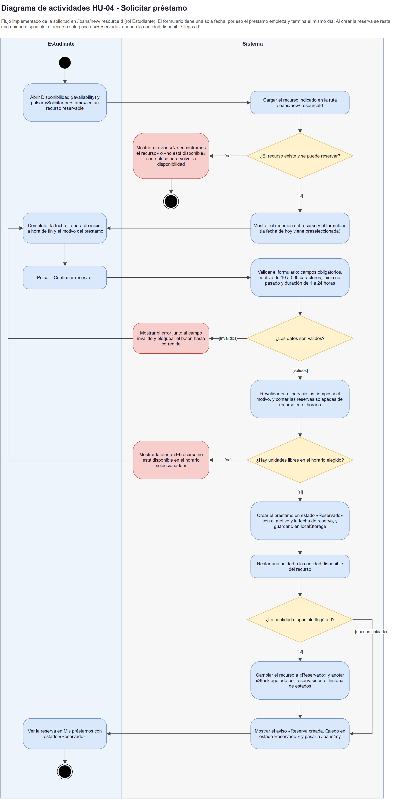

**Explicación:**
- Sobre `/loans/new/:resourceId` (rol Estudiante). El formulario valida motivo (10 a 500 caracteres), inicio no pasado y duración de 1 a 24 horas; el servicio vuelve a validar y cuenta las reservas solapadas del recurso.
- `createLoan` (`loans.service.ts`) crea el préstamo en estado «Reservado» y resta una unidad disponible. El recurso solo pasa a «Reservado» cuando la cantidad disponible llega a 0 («Stock agotado por reservas.»). Después se muestra el aviso y se navega a `/loans/my`.
- Código: `LoanFormPage`, `LoanForm`, `useLoanForm` y `validation.ts` en `features/loans/`.
- Diferencias con el E1: el formulario tiene una sola fecha, así que el préstamo empieza y termina el mismo día; **no** se implementó el límite de 3 préstamos activos (RN-03, segundo escenario de HU-04) ni el horario operativo (RN-05).

**Enlace editable:** https://app.diagrams.net/?url=<URL_CRUDA_DEL_ARCHIVO actividad-hu-04-solicitar-prestamo.drawio>

---

### 2.10 HU-05: Gestión de inventario

- **Nombre:** HU-05 Gestión de inventario (registrar, editar y dar de baja)
- **Nivel / historia:** Diagrama de actividades de HU-05 (RU-05, RF-03, RF-04 parcial, RN-02)
- **Archivo editable:** `docs/diagramas/actividad-hu-05-gestion-inventario.drawio`
- **Imagen:** `docs/diagramas/img/actividad-hu-05-gestion-inventario.png`

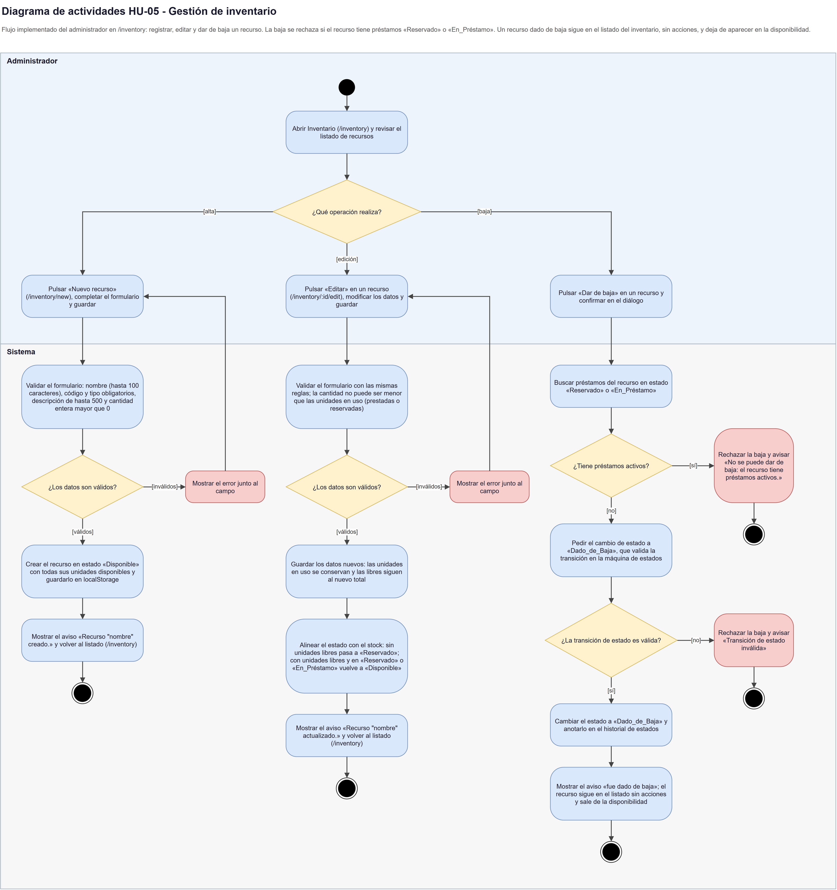

**Explicación:**
- Flujo del Administrador en `/inventory` con tres operaciones: alta (`/inventory/new`), edición (`/inventory/:id/edit`) y baja con confirmación. El alta crea el recurso en estado «Disponible»; la edición no permite una cantidad menor que las unidades en uso.
- `retireResource` (`resources.service.ts`) rechaza la baja si el recurso tiene préstamos «Reservado» o «En_Préstamo». Si no, valida la transición con `isValidTransition` y pasa a «Dado_de_Baja», dejando constancia en el historial de estados.
- Código: `features/inventory/` (`InventoryPage`, `ResourceFormPage`, `InventoryTable`, `ResourceForm`, `useInventory`, `useResourceForm`).
- Diferencias con el E1: solo el Administrador accede al inventario (el E1 incluía al Técnico); `updateResourceStatus` existe en el servicio pero ninguna pantalla lo usa, por lo que el cambio manual a mantenimiento del RF-04 no está disponible.

**Enlace editable:** https://app.diagrams.net/?url=<URL_CRUDA_DEL_ARCHIVO actividad-hu-05-gestion-inventario.drawio>

---

### 2.11 HU-06: Registrar entrega y devolución

- **Nombre:** HU-06 Registrar entrega y devolución
- **Nivel / historia:** Diagrama de actividades de HU-06 (RU-06, RF-06, RN-04)
- **Archivo editable:** `docs/diagramas/actividad-hu-06-entrega-devolucion.drawio`
- **Imagen:** `docs/diagramas/img/actividad-hu-06-entrega-devolucion.png`

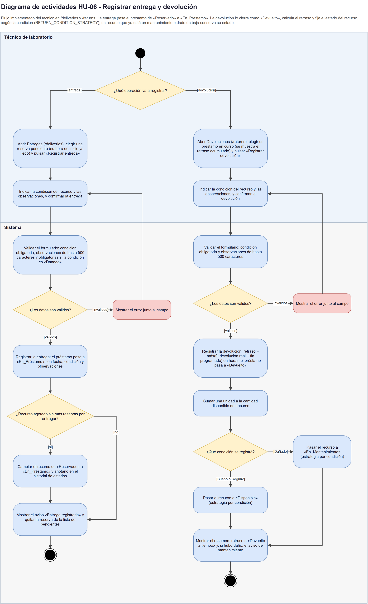

**Explicación:**
- Flujo del Técnico en `/deliveries` y `/returns` (el Administrador también tiene acceso a esas dos rutas según `NAV_GROUPS`). En ambos casos se indica la condición del recurso (Bueno, Regular o Dañado) y observaciones; solo la entrega exige observaciones cuando la condición es «Dañado».
- `registerDelivery` pasa el préstamo de «Reservado» a «En_Préstamo». `registerReturn` lo cierra como «Devuelto», calcula `retrasoHoras = max(0, devolución real - fin programado)` con `calculateDelayHours` y suma una unidad al stock.
- El estado final del recurso lo decide `RETURN_CONDITION_STRATEGY`: Bueno y Regular van a «Disponible» y Dañado a «En_Mantenimiento». Un recurso que ya estaba en mantenimiento o dado de baja conserva su estado.
- Código: `features/operations/` (`DeliveryPage`, `ReturnPage`, `ConditionForm`, `useDeliveries`, `useReturns`).
- Diferencia con el E1: el retraso se mide en horas y no existe el estado «Retrasado»; las sanciones por demora son Post-MVP.

**Enlace editable:** https://app.diagrams.net/?url=<URL_CRUDA_DEL_ARCHIVO actividad-hu-06-entrega-devolucion.drawio>

---

## 3. Cómo obtener el enlace editable

El entregable pide un enlace que permita abrir y editar el diagrama. Hay dos caminos. Ninguno está hecho todavía: este repositorio no tiene un enlace público de los diagramas, así que las URL de los bloques son marcadores.

**Opción A: «Open in draw.io» desde el repositorio (recomendada)**

1. Publicar el repositorio con `git push` (esta tarea no hizo push). El repositorio debe ser público para que el enlace funcione sin iniciar sesión.
2. Abrir el archivo `.drawio` en GitHub, pulsar **Raw** y copiar la URL de esa página (la «URL cruda»).
3. Armar el enlace con este patrón:

   `https://app.diagrams.net/?url=<URL_CRUDA_DEL_ARCHIVO>`

   Para GitHub, la URL cruda tiene la forma `https://raw.githubusercontent.com/<USUARIO>/<REPOSITORIO>/<RAMA>/docs/diagramas/<archivo>.drawio`. El remoto `origin` configurado en este repositorio es `https://github.com/aleospiria/Dise-o-de-sistemas-de-informacion-2026-02.git`; usuario y repositorio salen de ahí, pero la rama y la visibilidad hay que confirmarlas. Los nombres de archivo no tienen espacios ni tildes, así que no requieren codificación.
4. Probar el enlace en una ventana de incógnito antes de entregar. Si el diagrama se abre y se puede editar, está bien.

**Opción B: guardar el archivo en la nube desde diagrams.net**

1. Abrir https://app.diagrams.net y elegir **Archivo → Abrir desde → Dispositivo** para cargar el `.drawio`.
2. Elegir **Archivo → Guardar en** y seleccionar el servicio donde se quiera guardar (por ejemplo Google Drive, OneDrive o GitHub; las opciones dependen de la cuenta).
3. Obtener el enlace con **Archivo → Compartir** y dar permiso de edición o de lectura según lo que se quiera mostrar.

Notas:

- `c4-4-codigo.drawio` tiene dos páginas (4a y 4b). Con cualquiera de las dos opciones se usa **un solo enlace**; la 4b se elige en las pestañas inferiores. En el informe conviene indicar «página 4b» junto al enlace.
- Si el enlace va en un PDF, verificar que sea clicable y que no se haya cortado al final de línea.
- Pegar los enlaces definitivos también en la sección 7 (Anexos) del entregable, que pide «Enlaces editables de diagramas».

## 4. Cómo validar y regenerar

Todo se ejecuta desde `docs/diagramas/herramientas/` o con la ruta completa. Hace falta Python 3; draw.io Desktop solo para exportar.

**Validar los `.drawio`** (`validar_drawio.py`)

```powershell
python docs/diagramas/herramientas/validar_drawio.py
```

Sin argumentos revisa todos los `*.drawio` de `docs/diagramas/` (estructura XML, solapes y texto que no cabe en su caja). También acepta archivos o carpetas, y `--salida ruta.txt` para guardar el informe. Termina con código 0 si no hay errores. Resultado de la última ejecución: 10 archivos, 0 errores, 0 avisos.

**Regenerar las imágenes PNG** (`exportar_imagenes.py`)

```powershell
python docs/diagramas/herramientas/exportar_imagenes.py                    # todas
python docs/diagramas/herramientas/exportar_imagenes.py c4-1-contexto      # solo una
```

El script usa draw.io Desktop en modo línea de comandos (`C:\Program Files\draw.io\draw.io.exe` o `%LOCALAPPDATA%\Programs\draw.io\draw.io.exe`), escala 2, una imagen por página, y escribe en `img/`. Si no encuentra el ejecutable, termina con un mensaje.

Detalles que ya dieron problemas:

- La CLI de draw.io falla con rutas absolutas que contienen «ñ» (esta carpeta está dentro de «Diseño…»). El script lo evita ejecutando con `cwd` en `docs/diagramas` y rutas relativas.
- La opción `-p` cuenta las páginas desde 1.

**Si no se pueden regenerar las imágenes**, se exportan a mano desde draw.io: **Archivo → Exportar como → PNG**, con zoom 200 % y fondo blanco. En `c4-4-codigo.drawio` hay que exportar cada página por separado.

Después de editar un diagrama: validar, volver a exportar, revisar el PNG a simple vista (texto cortado, flechas sobre cajas) y pegar la imagen nueva en el informe.

## 5. Diferencias entre el E1 y el código

Los diagramas muestran lo que el código hace hoy. Lo que el Entregable 1 pedía y no está implementado **no se dibujó** como flujo, porque un diagrama de actividades de funcionalidades reales no debe incluir pasos que no existen (la guía del entregable exige que correspondan a lo implementado). Cada punto se comprobó en `sistemas-informacion/src/`.

| Tema | Qué decía el E1 | Qué hace el código | Cómo se refleja en los diagramas |
|---|---|---|---|
| Límite de 3 préstamos activos (RN-03; segundo escenario de HU-04) | Bloquear el 4.º préstamo con «Has alcanzado el límite máximo de préstamos (3)». | No existe la regla. `MAX_ACTIVE_SHOWN = 3` en `features/dashboard/components/StudentDashboard.tsx` solo limita cuántos préstamos se muestran en el panel. | HU-04 no tiene ese rombo. |
| Horario operativo (RN-05) | Rechazar solicitudes fuera del horario del laboratorio (ej. 7:00 a 20:00). | No existe: no hay ninguna constante ni validación de horario. | HU-04 y HU-03 no lo incluyen. |
| Cancelar reserva (Post-MVP) | Release posterior. | No hay `cancelLoan` ni botón para cancelar. `Reservado → Disponible` está en `RESOURCE_TRANSITIONS` con el comentario «cancelación (Post-MVP)» y lo usa también el ajuste de stock. | Sin flujo de cancelación. |
| Recuperar contraseña (Post-MVP) | Release posterior. | El enlace «¿Olvidaste tu contraseña?» solo muestra el aviso «La recuperación de contraseña estará disponible en una próxima versión.» (`useLoginForm.ts`). | HU-02 no tiene flujo de recuperación. |
| Rol Docente | Cuatro roles: Administrador, Técnico, Docente y Estudiante. | `UserRole` tiene tres: `Estudiante`, `Técnico_Laboratorio`, `Administrador_Laboratorio`. No hay coincidencias de «Docente» en `src/`. | C4-1 muestra tres personas. |
| Cédula (RF-01) | Numérica, única, de 6 a 10 dígitos. | Solo se exige que no esté vacía (`features/auth/validation.ts`). No se valida el formato ni la unicidad; la única unicidad que comprueba `registerUser` es la del correo. | HU-01 lo indica en la descripción. |
| Carnet (RF-01) | Opcional. | Obligatorio solo si el rol es Estudiante. | HU-01. |
| Asignación de roles (RF-02) | El Administrador asigna los roles. | El rol se elige en el formulario de registro (`ROLE_OPTIONS` en `RegisterForm.tsx`; valor inicial «Estudiante»). No hay pantalla de asignación. | Sin diagrama (RF-02 no tiene HU en el E1). |
| Mensaje de login inválido (HU-02) | «Usuario o contraseña inválidos». | «Correo o contraseña incorrectos.» (genérico). | HU-02 usa el texto real. |
| Consulta de disponibilidad (RF-05, HU-03) | Elegir un recurso y rango de fechas y horas; mostrar «Libre» u «Ocupado». | Listado con filtros opcionales por nombre, tipo, fecha y hora; tarjetas «Disponible» o «No disponible» con la fecha de liberación; ventana fija de una hora. | HU-03 refleja el listado. |
| Gestión de inventario (RU-05, HU-05) | Técnico o Administrador. | Solo el Administrador (`/inventory` en `NAV_GROUPS`). | HU-05 tiene un solo actor. |
| Cambio manual de estado (RF-04) | El Técnico cambia el recurso a «En mantenimiento» o «Defectuoso». | `updateResourceStatus` existe en el servicio, pero `features/` no lo invoca. La única vía a `En_Mantenimiento` en la interfaz es una devolución con condición «Dañado». | HU-06 muestra esa vía; HU-05 no tiene cambio de estado. |
| Estados de recurso | Disponible, Prestado, Reservado, Mantenimiento, Defectuoso, Baja. | `Disponible`, `Reservado`, `En_Préstamo`, `En_Mantenimiento`, `Dado_de_Baja`. «Defectuoso» se modela con la condición `Dañado`. | C4-4a y C4-4b. |
| Estados de préstamo (RN-04) | Reservado, Activo, Devuelto, Retrasado. | `LoanStatus` es `Reservado`, `En_Préstamo`, `Devuelto`, `Cancelado`, `Vencido`. **Ningún flujo asigna `Cancelado` ni `Vencido`**: `Cancelado` solo aparece en un préstamo de `seed-data.ts` y `Vencido` solo en el tipo y en `StatusBadge`. «Retrasado» no existe; el retraso queda en `retrasoHoras`. | HU-06 solo recorre Reservado → En_Préstamo → Devuelto. C4-4a lo anota. |
| Cálculo de retraso (RF-06) | Días de retraso y sanciones. | Horas: `max(0, devolución real - fin programado)`. Sin sanciones. | HU-06. |
| Sanciones y reportes (Post-MVP) | Gestión de sanciones y reporte de préstamos. | No hay rutas `/sanctions` ni `/reports`. `Sanction` y `SanctionStatus` están declarados en `shared/types` y `seed-data.ts` siembra un arreglo vacío; `User.sanctionEndDate` nunca se escribe. | C4-4a los marca como Post-MVP; C4-2 marca la clave `sanctions` como sin uso. |
| Historial de estados (`EstadoRecurso`) | Clase auxiliar de historial. | Se escribe en cada cambio válido (`appendStatusHistory` en `resources.service.ts`), pero no hay pantalla que lo lea. | C4-2 marca la clave `status-history` como «solo se escribe». |
| Duración del préstamo | No especificada. | Mínimo 1 hora y máximo 24 horas (`validators.ts`); el formulario tiene una sola fecha, así que empieza y termina el mismo día. | HU-04. |
| Despliegue (nginx, Docker) | No estaba en el E1. | Solo en la rama `feature/deploy-docker`; `main` no tiene `Dockerfile` ni `nginx.conf`. | C4-2 lo dibuja en gris como futuro. |
| Requisitos no funcionales (RNF-01 a RNF-03) | Tiempos de respuesta, carga y navegadores. | No hay mediciones en el repositorio. | No se dibujan; si el informe los cita, hay que decir que no se midieron. |

## 6. Patrones candidatos

Los rótulos amarillos «patrón candidato (por confirmar en la sección 3 del entregable)» del nivel 4b son **candidatos**, no la selección definitiva. La sección 3 del entregable exige elegir **cinco patrones distintos**, justificados con la plantilla de patrones GoF, y esa elección todavía no está hecha.

| Candidato en el diagrama | Dónde está en el código | Observación |
|---|---|---|
| Repository / Adapter | Puerto `StorageRepository` con `LocalStorageRepository` e `InMemoryStorageRepository` (`services/storage/`) | El rótulo mezcla dos nombres; hay que elegir uno. |
| Strategy | `RETURN_CONDITION_STRATEGY` (`shared/constants/resourceStateMachine.ts`) | Es una tabla de datos, no objetos Strategy. |
| State | `RESOURCE_TRANSITIONS` e `isValidTransition` (mismo archivo) | Es una tabla declarativa, no clases State. |
| Adapter | `createResolver` (`shared/utils/formResolver.ts`) adapta una función de validación al `Resolver` de React Hook Form | Si se elige Adapter aquí, no se puede repetir en el puerto de almacenamiento. |
| Facade | `AuthProvider` y `AppDataProvider` (`contexts/`) exponen los servicios con el repositorio ya inyectado | Las páginas no importan de `services/`. |

Antes de cerrar la sección 3 hay que decidir cuáles cinco se entregan, evitar el solape Adapter / Repository, justificar que son implementaciones reales y no solo etiquetas, y actualizar los rótulos del diagrama 4b para que coincidan con esa decisión. Los diagramas C4 y de actividades no dependen de esa elección.
