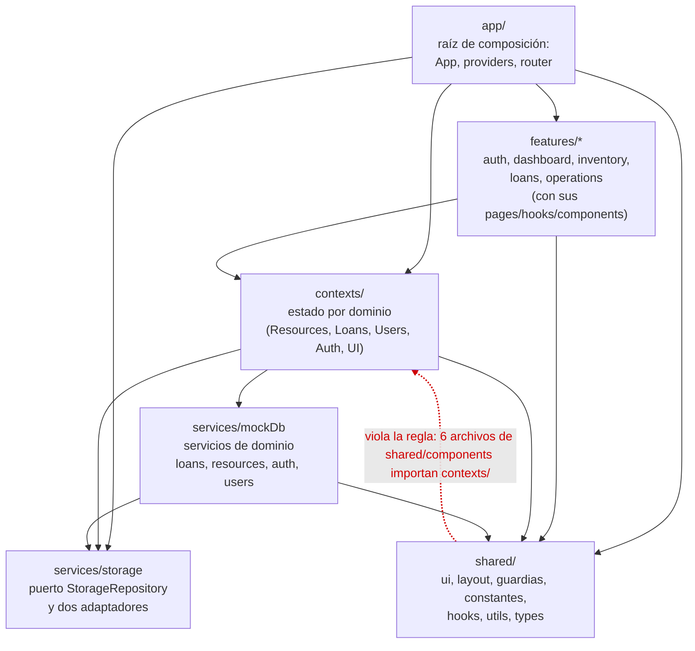
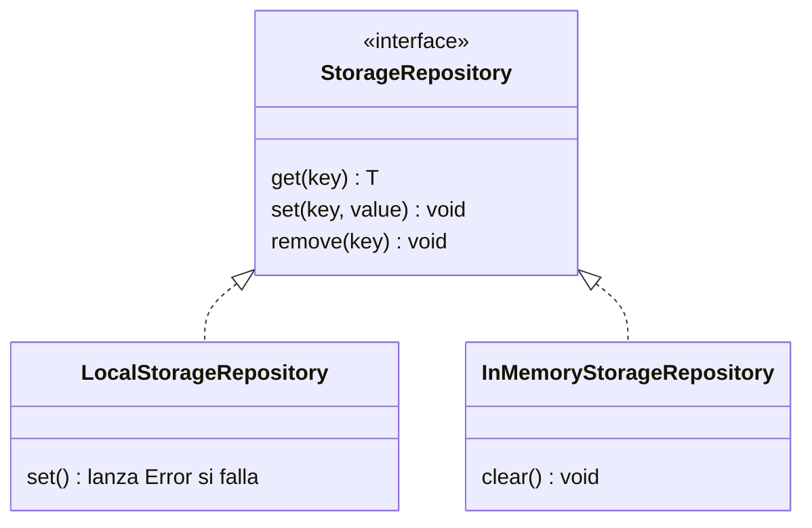
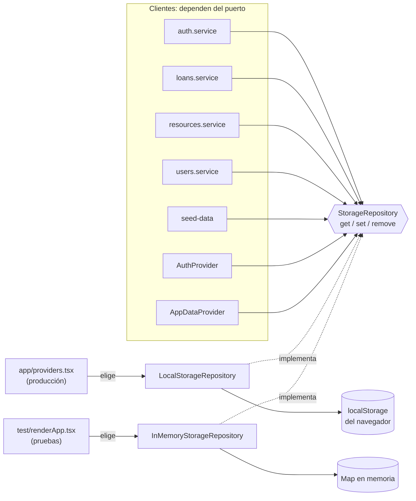
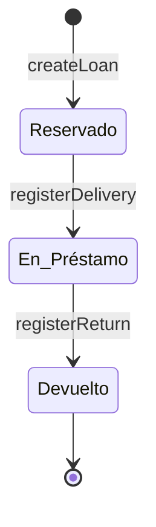
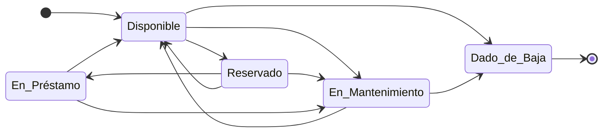
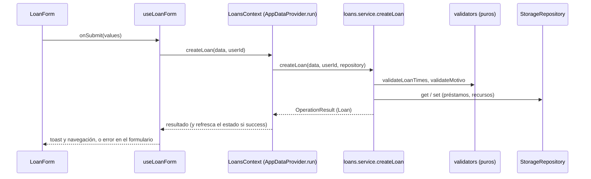

# SOLID aplicado en el frontend del sistema de préstamos

Guía para explicar y demostrar los principios SOLID en el frontend del Sistema de Gestión de Préstamo de Recursos de Laboratorio (ITM, curso Diseño de Sistemas de Información). Sirve para estudiar, para exponer y para responder preguntas del docente.

- **Código analizado:** commit `fcad2f3` (rama `main`), MVP del frontend terminado.
- **Estado de las pruebas:** `npx vitest run` → 17 archivos y 350 pruebas en verde (324 unitarias y 26 de propiedades con fast-check). `npx tsc -b --noEmit` termina sin errores.
- **Documento formal:** el análisis completo con la plantilla oficial está en `.kiro/specs/analisis-solid/solid-analysis.md`. Esta guía es la versión para contarlo.
- **Rutas:** relativas a `sistemas-informacion/src/` salvo que se indique otra raíz. Todos los comandos se ejecutan desde `sistemas-informacion/`.
- **Cómo leer los bloques de código:** el rótulo **ANTES (ilustrativo, inventado)** marca código escrito para esta guía que **no existe** en el repositorio. El rótulo **DESPUÉS (código real)** marca fragmentos copiados del repositorio, con su ruta y líneas.

---

## 1. La idea central (una página)

**SOLID sirve para que lo que cambia, cambie en un solo lugar.** En este proyecto hay cuatro cosas que cambian con frecuencia:

1. **Las reglas del negocio:** la duración mínima y máxima de un préstamo, qué estados puede tener un recurso, qué pasa si se devuelve dañado.
2. **Los catálogos:** roles, tipos de recurso, estados, opciones del menú, paneles de inicio.
3. **El almacenamiento:** hoy es el `localStorage` del navegador; mañana será una API.
4. **La interfaz:** formularios, pantallas, componentes.

Como no hay backend, el "afuera" del sistema es poco: el `localStorage`, el reloj y React Router. Aun así, el proyecto lo trata como si fuera un sistema con dependencias externas, y por eso cada principio tiene un uso concreto:

| Principio | Idea en una frase | Dónde se ve en este proyecto |
|---|---|---|
| **S**RP | Un módulo, una razón para cambiar | Reglas puras en `validators.ts`; el hook del formulario separado del componente que lo dibuja |
| **O**CP | Extender editando datos, no funciones | `RESOURCE_TRANSITIONS`, `NAV_GROUPS`, `DASHBOARD_VIEWS`, `STATUS_BADGE` |
| **L**SP | Una implementación puede reemplazar a otra | `InMemoryStorageRepository` y `LocalStorageRepository` detrás de `StorageRepository` |
| **I**SP | Cada cliente depende solo de lo que usa | Un contexto por dominio: `useResources`, `useLoans`, `useUsers`, `useAuth`, `useToast` |
| **D**IP | La lógica depende de abstracciones | El puerto `StorageRepository` se inyecta; `app/providers.tsx` elige la implementación |

**Lo que hay que decir con honestidad desde el primer minuto:** el diseño cumple bien OCP y tiene un buen puerto de persistencia, pero no cumple SOLID por completo. Los niveles del análisis son **OCP alto** y **SRP, LSP, ISP y DIP medios**. La deuda más importante es que tres servicios pueden lanzar una excepción si falla el almacenamiento (sección 5). El proyecto la documenta en lugar de esconderla.

**Evolución desde el Entregable 1.** El diagrama de clases del Entregable 1 (`Usuario`, `Rol`, `Recurso`, `Prestamo`, `EstadoRecurso`) se convirtió en tipos de dominio, servicios y tablas declarativas. Los componentes que se analizan son los que cambiaron en esa evolución: la máquina de estados de recurso, los servicios de préstamos y recursos, el puerto de persistencia, los contextos y la navegación por rol.

---

## 2. Diagramas

### 2.1 Capas y dependencias

Las flechas van de quien depende hacia quien es dependido. La flecha roja es una **violación conocida** de la regla de capas.



Otras notas del mapa real:
- Ningún archivo de `features/` ni de `shared/` importa de `services/`. Solo `contexts/` (y `app/providers.tsx`, que importa el puerto) los conocen.
- `features/loans` y `features/inventory` se importan entre sí: `AvailabilityPage` usa `ResourceCard`, y `ResourceCard` importa el tipo `Reservation` de `loans/availability`.
- No existe una carpeta `pages/` global: las páginas están dentro de cada feature.

### 2.2 El puerto `StorageRepository` y sus adaptadores



Quién usa el puerto y quién elige la implementación:



### 2.3 Flujo reserva → entrega → devolución

Estados del **préstamo** (los únicos que ocurren en el MVP; `Cancelado` y `Vencido` existen como tipo, pero ningún código los asigna):



Estados del **recurso** (tabla `RESOURCE_TRANSITIONS`, sección 4). `Reservado → Disponible` existe para la cancelación futura (Post-MVP) y también lo usa la conciliación de stock:



Qué cambia en cada paso del ciclo (esto es lo que hace el código, con sus matices):

| Acción (función en `services/mockDb/loans.service.ts`) | Estado del préstamo | Estado y stock del recurso |
|---|---|---|
| `createLoan` (línea 105) | (nuevo) → `Reservado` | `cantidadDisponible` baja en 1. El recurso pasa de `Disponible` a `Reservado` **solo si** la cantidad llega a 0 (motivo "Stock agotado por reservas."). Si quedan unidades, sigue `Disponible`. |
| `registerDelivery` (línea 224) | `Reservado` → `En_Préstamo` | El recurso pasa de `Reservado` a `En_Préstamo` solo si estaba `Reservado` y no quedan otras reservas pendientes de entrega del mismo recurso. |
| `registerReturn` (línea 272) | `En_Préstamo` → `Devuelto`, con `retrasoHoras` | `cantidadDisponible` sube en 1. El nuevo estado sale de `RETURN_CONDITION_STRATEGY`: `Bueno` y `Regular` → `Disponible`; `Dañado` → `En_Mantenimiento`. Un recurso ya en mantenimiento o dado de baja no se modifica. |

Secuencia de una reserva, para mostrar quién conoce a quién:



---

## 3. S — Responsabilidad única (SRP)

**Un módulo debe tener una sola razón para cambiar.**

### ¿Qué problema evita?

Que un cambio en una regla (por ejemplo, "el préstamo dura máximo 24 horas") obligue a tocar la pantalla, el almacenamiento y los tests a la vez. Cuando un archivo mezcla reglas, datos y presentación, un cambio pequeño rompe cosas que no tenían relación.

### ANTES (ilustrativo, inventado)

```tsx
// ILUSTRATIVO: código inventado para esta guía. NO existe en el repositorio.
function LoanForm({ resourceId }: { resourceId: string }) {
  function onSubmit(fecha: string, horaInicio: string, horaFin: string) {
    // 1) validación incrustada en la pantalla
    const horas =
      (new Date(`${fecha}T${horaFin}`).getTime() - new Date(`${fecha}T${horaInicio}`).getTime()) / 3600000
    if (horas < 1 || horas > 24) {
      alert('Duración inválida')
      return
    }
    // 2) acceso directo a los datos
    const loans = JSON.parse(localStorage.getItem('loans') ?? '[]') as unknown[]
    loans.push({ resourceId, fecha, horaInicio, horaFin, estado: 'Reservado' })
    localStorage.setItem('loans', JSON.stringify(loans))
    // 3) regla de stock mezclada con la pantalla
    const resources = JSON.parse(localStorage.getItem('resources') ?? '[]') as { id: string; disponibles: number }[]
    const r = resources.find((x) => x.id === resourceId)
    if (r) r.disponibles -= 1
    localStorage.setItem('resources', JSON.stringify(resources))
  }
  return null // aquí iría el formulario
}
```

Para probar la regla de 24 horas habría que montar el componente y simular el navegador. Si cambia la regla, hay que editar la pantalla.

### DESPUÉS (código real)

**La regla vive en una función pura** (`shared/utils/validators.ts:50-78`):

```ts
export function validateLoanTimes(
  start: string,
  end: string,
): LoanTimesValidation {
  const startMs = new Date(start).getTime()
  const endMs = new Date(end).getTime()

  if (Number.isNaN(startMs) || Number.isNaN(endMs)) {
    return { valid: false, error: 'Fechas inválidas.' }
  }
  if (isDateInPast(start)) {
    return { valid: false, error: 'La fecha de inicio no puede estar en el pasado.' }
  }

  const durationHours = (endMs - startMs) / MS_PER_HOUR
  if (durationHours < MIN_LOAN_HOURS) {
    return {
      valid: false,
      error: 'La duración mínima del préstamo es de 1 hora.',
    }
  }
  if (durationHours > MAX_LOAN_HOURS) {
    return {
      valid: false,
      error: 'La duración máxima del préstamo es de 24 horas.',
    }
  }
  return { valid: true }
}
```

**La reutilizan el formulario y el servicio.** El formulario muestra el error junto al campo (`features/loans/validation.ts:32-39`):

```ts
  if (start && end) {
    const times = validateLoanTimes(start, end)
    if (!times.valid) {
      // Inicio en el pasado se atribuye a la fecha; el resto, a la hora de fin.
      if (isDateInPast(start)) errors.fecha = times.error
      else errors.horaFin = times.error
    }
  }
```

y el servicio la vuelve a aplicar antes de guardar (`services/mockDb/loans.service.ts:110-116`):

```ts
  const times = validateLoanTimes(
    data.fechaHoraInicioProgramada,
    data.fechaHoraFinProgramada,
  )
  if (!times.valid) {
    return { success: false, error: times.error }
  }
```

**El hook separa la lógica del formulario de lo que se dibuja.** `components/LoanForm.tsx` solo llama a `useLoanForm`; el hook adapta la función pura a React Hook Form con `createResolver` (`features/loans/hooks/useLoanForm.ts:11` y `:17-27`):

```ts
const resolver = createResolver(validateLoanForm)
```

```ts
export function useLoanForm(resourceId: string) {
  const { session } = useAuth()
  const { createLoan } = useLoans()
  const { showToast } = useToast()
  const navigate = useNavigate()

  const form = useForm<LoanFormValues>({
    defaultValues: { fecha: toDateInputValue(), horaInicio: '', horaFin: '', motivo: '' },
    resolver,
  })
```

**El servicio solo orquesta.** Lo declara su cabecera (`services/mockDb/loans.service.ts:3-4`): el servicio orquesta; la validación es pura y la persistencia pasa por el repositorio.

### Cómo demostrarlo en vivo

1. **Abrir, en este orden:** `shared/utils/validators.ts`, `features/loans/validation.ts`, `features/loans/hooks/useLoanForm.ts`, `features/loans/components/LoanForm.tsx`.
2. **Correr las pruebas de la regla** (no necesitan React ni almacenamiento):
   ```
   npx vitest run src/__tests__/unit/utils.test.ts -t "validateLoanTimes"
   ```
   Resultado verificado: 2 pruebas pasan (8 omitidas). Incluye `validateLoanTimes respeta mínimo 1h y máximo 24h`.
3. **Correr las propiedades** (fast-check genera cientos de casos por prueba):
   ```
   npx vitest run src/__tests__/properties/validators.property.test.ts
   ```
   Resultado verificado: 11 pruebas pasan (`Propiedades de validatePassword`, `Propiedades de validateLoanTimes` y otras).
4. **Cambio mínimo para mostrar:** en `shared/utils/validators.ts` cambiar `MAX_LOAN_HOURS = 24` por otro valor. La regla cambia en un solo lugar y el formulario y el servicio la heredan. Revertir con `git checkout -- src/shared/utils/validators.ts`.

### Lo que falta (decirlo)

- `loans.service.ts` (313 líneas) tiene 8 funciones: además de reservar, entregar y devolver, aloja las consultas de disponibilidad (`checkAvailability`, `getAvailableResources`) y los listados. Tiene más de una razón para cambiar: consulta, comandos del ciclo y efectos sobre el stock y el estado del recurso conviven en el mismo archivo. En la historia, el commit `7575ca3` introdujo este servicio y, en el mismo commit, amplió la tabla de transiciones; eso muestra el acoplamiento entre el ciclo del préstamo y las reglas de estado, no un cambio posterior del servicio.
- `resources.service.ts:247` lee directamente la clave de préstamos (`repo.get<Loan[]>(LS_KEYS.LOANS)`): conoce el almacenamiento de otro agregado.
- "Préstamo activo" (`Reservado` o `En_Préstamo`) está escrito en 4 archivos: `loans.service.ts:55`, `resources.service.ts:251`, `features/loans/availability.ts:62` y `features/dashboard/summaries.ts:43`.

---

## 4. O — Abierto/cerrado (OCP)

**Las entidades deben estar abiertas para extensión y cerradas para modificación.** Aquí la extensión se hace **editando datos, no funciones**.

### ¿Qué problema evita?

Que agregar un estado, un rol o un tipo de recurso obligue a buscar `if` y `switch` repartidos por el código. Cada condicional olvidado es un error silencioso.

### ANTES (ilustrativo, inventado)

```ts
// ILUSTRATIVO: código inventado para esta guía. NO existe en el repositorio.
function canTransition(from: string, to: string): boolean {
  if (from === 'Disponible' && (to === 'Reservado' || to === 'Dado_de_Baja')) return true
  if (from === 'Reservado' && (to === 'En_Préstamo' || to === 'Disponible')) return true
  if (from === 'En_Préstamo' && to === 'Disponible') return true
  if (from === 'En_Mantenimiento' && (to === 'Disponible' || to === 'Dado_de_Baja')) return true
  return false
}
```

Cada transición nueva obliga a editar la función. Si se agrega el estado `En_Calibración`, nada avisa de que falta.

### DESPUÉS (código real)

**La tabla** (`shared/constants/resourceStateMachine.ts:20-29`):

```ts
export const RESOURCE_TRANSITIONS: Record<ResourceStatus, ResourceStatus[]> = {
  // En_Mantenimiento desde Disponible/Reservado: un recurso con varias
  // unidades puede recibir una devolución dañada mientras otras siguen libres
  // o reservadas (Req 13.9).
  Disponible: ['Reservado', 'En_Mantenimiento', 'Dado_de_Baja'],
  Reservado: ['En_Préstamo', 'Disponible', 'En_Mantenimiento'], // Disponible = cancelación (Post-MVP)
  En_Préstamo: ['Disponible', 'En_Mantenimiento'],
  En_Mantenimiento: ['Disponible', 'Dado_de_Baja'],
  Dado_de_Baja: [], // estado terminal
}
```

**La función que la consulta nunca cambia** (`:34-39`):

```ts
export function isValidTransition(
  from: ResourceStatus,
  to: ResourceStatus,
): boolean {
  return RESOURCE_TRANSITIONS[from].includes(to)
}
```

**La estrategia de devolución también es una tabla** (`:47-54`):

```ts
export const RETURN_CONDITION_STRATEGY: Record<
  ResourceCondition,
  { nuevoEstado: ResourceStatus }
> = {
  Bueno: { nuevoEstado: 'Disponible' },
  Regular: { nuevoEstado: 'Disponible' },
  Dañado: { nuevoEstado: 'En_Mantenimiento' },
}
```

**El panel de inicio de cada rol** (`features/dashboard/pages/DashboardPage.tsx:13-17`):

```ts
const DASHBOARD_VIEWS: Record<UserRole, ComponentType> = {
  Estudiante: StudentDashboard,
  Técnico_Laboratorio: TechnicianDashboard,
  Administrador_Laboratorio: AdminDashboard,
}
```

**El distintivo de cada estado** (`shared/components/ui/StatusBadge.tsx:14-23`):

```ts
const STATUS_BADGE: Record<BadgeStatus, { label: string; tone: Tone }> = {
  Disponible: { label: 'Disponible', tone: 'green' },
  Reservado: { label: 'Reservado', tone: 'yellow' },
  En_Préstamo: { label: 'En préstamo', tone: 'blue' },
  En_Mantenimiento: { label: 'En mantenimiento', tone: 'orange' },
  Dado_de_Baja: { label: 'Dado de baja', tone: 'gray' },
  Devuelto: { label: 'Devuelto', tone: 'green' },
  Cancelado: { label: 'Cancelado', tone: 'gray' },
  Vencido: { label: 'Vencido', tone: 'red' },
}
```

**El menú y los guardias comparten una sola fuente.** `NAV_GROUPS` (`shared/constants/navigation.ts:26`) define quién ve cada opción, y `getRolesForRoute` (`:74`) alimenta los `RoleGuard` del router, de modo que el menú y el control de acceso no se pueden desincronizar (`app/router.tsx`: `guarded(getRolesForRoute('/loans/my'), …)`).

**Evidencia histórica real.** El commit `7575ca3` (21/10/2026) introdujo `loans.service.ts` y, en el mismo commit, ajustó `resourceStateMachine.ts` para permitir la devolución dañada de recursos con varias unidades. Dentro de ese archivo solo cambiaron líneas de la tabla (7 líneas); `isValidTransition` no se tocó:

```diff
-  Disponible: ['Reservado', 'Dado_de_Baja'],
-  Reservado: ['En_Préstamo', 'Disponible'], // Disponible = cancelación (Post-MVP)
+  // En_Mantenimiento desde Disponible/Reservado: un recurso con varias
+  // unidades puede recibir una devolución dañada mientras otras siguen libres
+  // o reservadas (Req 13.9).
+  Disponible: ['Reservado', 'En_Mantenimiento', 'Dado_de_Baja'],
+  Reservado: ['En_Préstamo', 'Disponible', 'En_Mantenimiento'], // Disponible = cancelación (Post-MVP)
```

### Cómo demostrarlo en vivo

**Demostración principal: agregar el tipo de recurso `Reactivo` (2 archivos).** Está verificada sobre una copia del proyecto: el compilador falla en el primer paso y queda limpio en el segundo, y las 350 pruebas pasan.

1. Abrir `shared/types/index.ts`, línea 35:
   ```ts
   export type ResourceType = 'Equipo' | 'Herramienta' | 'Material';
   ```
   y agregar `| 'Reactivo'` al final de la unión.
2. Correr `npx tsc -b --noEmit`. Falla y **señala lo que falta**:
   ```
   src/shared/constants/resourceTypes.ts(7,14): error TS2741: Property 'Reactivo' is missing in type '{ Equipo: string; Herramienta: string; Material: string; }' but required in type 'Record<ResourceType, string>'.
   ```
3. Abrir `shared/constants/resourceTypes.ts` y agregar `Reactivo: 'Reactivo',` dentro de `RESOURCE_TYPE_LABELS`, después de `Material: 'Material',`.
4. Correr `npx tsc -b --noEmit` (sale limpio) y `npx vitest run` (350 pruebas en verde).
5. Con `npm run dev` (http://localhost:5173) entrar como administrador y abrir Inventario → Nuevo recurso: el tipo `Reactivo` aparece en el formulario y en los filtros de Disponibilidad **sin tocar esos componentes**, porque se alimentan de `RESOURCE_TYPES`.
6. **Revertir (no hacer commit):** `git checkout -- src/shared/types/index.ts src/shared/constants/resourceTypes.ts`.

Variantes si se quiere mostrar más trabajo del compilador (medidas con `tsc` sobre copias del proyecto):

| Cambio | Lo que señala el compilador |
|---|---|
| Agregar `'En_Calibración'` a `ResourceStatus` | `StatusBadge.tsx` y `resourceStateMachine.ts` |
| Agregar `'Incompleto'` a `ResourceCondition` | `conditions.ts` y `resourceStateMachine.ts` |
| Agregar `'Docente'` a `UserRole` | `roles.ts`, `DashboardPage.tsx` y `router.test.tsx` (en las pruebas). `NAV_GROUPS` **hay que ajustarlo a mano**: el compilador no lo exige, y sin ese ajuste el rol solo vería "Inicio" y "Disponibilidad". |

**Pruebas para correr:**
```
npx vitest run src/__tests__/unit/utils.test.ts -t "resourceStateMachine"
npx vitest run src/__tests__/properties/resources.property.test.ts
npx vitest run src/__tests__/unit/ui.test.tsx -t "StatusBadge"
npx vitest run src/__tests__/unit/router.test.tsx
```
Resultados verificados: 2 pruebas pasan (`valida transiciones según la tabla declarativa` y `estrategia de devolución mapea condición a estado`); 6 pasan en el archivo de propiedades (incluyen `rechaza toda transición ausente de la tabla y no modifica el recurso` y `acepta toda transición de la tabla y registra el cambio en el historial`, con 100 iteraciones cada una, generadas **desde la tabla**: si cambia la tabla, la prueba la sigue); 1 pasa para `StatusBadge`; 36 pasan en el archivo del router, que cruza el menú con los guardias.

### Lo que falta (decirlo)

- Hay literales de dominio fuera de las tablas. La regla "Dañado exige observaciones" está escrita en 3 sitios (`loans.service.ts:239`, `features/operations/validation.ts:29`, `features/operations/hooks/useConditionForm.ts:46`), y `features/operations/hooks/useReturns.ts:64` repite que `Dañado` va a mantenimiento sin consultar `RETURN_CONDITION_STRATEGY`. `'Estudiante'` aparece como literal en 4 líneas (`features/auth/validation.ts:51`, `useRegisterForm.ts:44` y `:65`, `AvailabilityPage.tsx:32`).
- El único `switch` del código es el reducer de `AppDataProvider.tsx:76`, con 2 acciones (mejora M7, pendiente y de bajo valor).

---

## 5. L — Sustitución de Liskov (LSP)

**Los objetos de una subclase deben poder sustituir a los de su clase base sin alterar el comportamiento esperado.**

**Aclaración que conviene dar antes de que pregunten:** este proyecto está escrito en TypeScript funcional y **no usa herencia de clases de dominio**. Las únicas relaciones `implements` son las dos implementaciones del puerto de almacenamiento. Por eso LSP se evalúa a nivel de **contrato** (interfaz y postcondiciones): una implementación puede reemplazar a otra sin que el cliente cambie.

### ¿Qué problema evita?

Que cambiar de implementación (por ejemplo, de `localStorage` a un almacenamiento en memoria o a una API) obligue a modificar a los clientes, o que el cliente tenga que preguntar "¿qué tipo eres?" antes de usarla.

### ANTES (ilustrativo, inventado)

```ts
// ILUSTRATIVO: código inventado para esta guía. NO existe en el repositorio.
class SoloLecturaRepository implements StorageRepository {
  get<T>(key: string): T | null {
    return JSON.parse(localStorage.getItem(key) ?? 'null') as T | null
  }
  set(): void {
    throw new Error('No soportado') // rompe la expectativa del contrato
  }
  remove(): void {
    throw new Error('No soportado')
  }
}

// El cliente tiene que conocer el subtipo para no romperse:
if (repo instanceof SoloLecturaRepository) {
  mostrarAviso('Modo solo lectura')
} else {
  repo.set('prestamos', prestamos)
}
```

### DESPUÉS (código real)

**El contrato** (`services/storage/StorageRepository.ts:8-15`):

```ts
export interface StorageRepository {
  /** Lee y deserializa el valor asociado a `key`. Devuelve `null` si no existe. */
  get<T>(key: string): T | null
  /** Serializa y guarda `value` bajo `key`. */
  set<T>(key: string, value: T): void
  /** Elimina la entrada asociada a `key`. */
  remove(key: string): void
}
```

**Las dos implementaciones.** Producción (`LocalStorageRepository.ts:23-32`) y pruebas (`InMemoryStorageRepository.ts:19-21`):

```ts
  set<T>(key: string, value: T): void {
    try {
      localStorage.setItem(key, JSON.stringify(value))
    } catch (error) {
      throw new Error(
        `No se pudo guardar en el almacenamiento local (clave: ${key}).`,
        { cause: error },
      )
    }
  }
```

```ts
  set<T>(key: string, value: T): void {
    this.store.set(key, JSON.stringify(value))
  }
```

Las dos serializan con JSON, comparten la firma `get/set/remove` y los servicios no saben cuál reciben: todos los tests de servicios y contextos usan el repositorio en memoria sin que el código bajo prueba cambie.

**El segundo contrato: `OperationResult<T>`** (`shared/types/index.ts:160`). Los servicios devuelven `{ success, data, error }` en lugar de lanzar excepciones.

**Fallos de almacenamiento, probados.** Para `auth.service` hay un repositorio falso que lanza al escribir (`__tests__/unit/services.test.ts:109-120`):

```ts
    /** Lee del repositorio real, pero toda escritura o borrado lanza. */
    function failingRepo(): StorageRepository {
      return {
        get: repo.get.bind(repo),
        set: () => {
          throw new Error('Cuota excedida')
        },
        remove: () => {
          throw new Error('Almacenamiento bloqueado')
        },
      }
    }
```

y el servicio convierte el fallo en un resultado de error con un ayudante privado (`services/mockDb/auth.service.ts:47-54`):

```ts
function tryWrite(write: () => void): boolean {
  try {
    write()
    return true
  } catch {
    return false
  }
}
```

### Cómo demostrarlo en vivo

1. **Abrir lado a lado:** `services/storage/StorageRepository.ts`, `LocalStorageRepository.ts` e `InMemoryStorageRepository.ts`.
2. **Comprobar que `localStorage` solo lo toca un archivo:**
   ```
   git grep -nE "localStorage\.(get|set|remove)Item" -- src
   ```
   Resultado verificado: exactamente 3 líneas, todas en `src/services/storage/LocalStorageRepository.ts` (líneas 14, 25 y 36).
3. **Correr las pruebas que fijan la postcondición:**
   ```
   npx vitest run src/__tests__/unit/services.test.ts -t "postcondición"
   npx vitest run src/__tests__/unit/services.test.ts -t "cuando el almacenamiento lanza"
   npx vitest run src/__tests__/unit/contexts.test.tsx
   ```
   Resultados verificados: 1 prueba (`ninguna operación lanza excepción ante entradas inexistentes`), 4 pruebas (las de `auth.service` con repositorio que falla) y 18 pruebas en `contexts.test.tsx`.
4. **Mostrar que los tests usan el repositorio en memoria:** abrir `__tests__/unit/services.test.ts` y señalar el `beforeEach` (líneas 44-47), que crea `new InMemoryStorageRepository()` y lo siembra con `seedData(repo)`.

### Lo que falta (decirlo; es el principio con más deuda real)

- **El contrato está incompleto.** `LocalStorageRepository.set` lanza (cuota excedida, modo privado), `InMemoryStorageRepository.set` nunca lanza, y la interfaz no lo documenta.
- **Tres servicios incumplen su postcondición.** `resources.service` (`writeResources` línea 32, `appendStatusHistory` línea 41), `loans.service` (`writeLoans` línea 51) y `users.service` (`updateUser` línea 45) llaman a `repo.set` sin proteger. Se comprobó con un almacenamiento simulado que falla al escribir: `createResource`, `updateUser` y `createLoan` **lanzaron** en lugar de devolver `{ success: false }`.
- **Datos a medias.** `createLoan` escribe el préstamo (línea 152) y después ajusta el stock (154). Con un almacenamiento que falla desde la segunda escritura, el préstamo quedó guardado y el stock sin descontar. Hoy `AppDataProvider.run` (`contexts/AppDataProvider.tsx:119-134`) captura la excepción y la interfaz muestra un error, pero no deshace lo ya escrito.
- **Las cabeceras de los servicios afirman más de lo que se cumple.** `loans.service.ts` dice "toda función retorna `OperationResult`; nunca lanza". Eso no es cierto cuando falla el almacenamiento. No debe usarse como evidencia.
- **Ninguna prueba ejercita `LocalStorageRepository`.** Los 350 tests usan el repositorio en memoria o repositorios falsos. La sustituibilidad real↔fake se sostiene por lectura del código, no por una prueba de contrato.
- `OperationResult` no es una unión discriminada: un `{ success: true }` sin `data` compila.

---

## 6. I — Segregación de interfaces (ISP)

**Los clientes no deben depender de interfaces que no utilizan.**

### ¿Qué problema evita?

Que un componente que solo lee la sesión se vuelva a dibujar cada vez que cambia la lista de préstamos, o que dependa de funciones que nunca llama.

### ANTES (ilustrativo, inventado)

```tsx
// ILUSTRATIVO: código inventado para esta guía. NO existe en el repositorio.
// Un único contexto "todo en uno":
const { resources, loans, users, session, toasts, createLoan, registerReturn,
        createResource, login, logout, showToast, /* ... 20 miembros más */ } = useAppData()

function Sidebar() {
  const { session } = useAppData() // solo necesita la sesión
  // ...pero se vuelve a renderizar cuando cambia cualquier préstamo o recurso
}
```

El diagnóstico original del Entregable 2 marcó justamente este diseño (`useAppData`) como "No cumple".

### DESPUÉS (código real)

**Un contexto por dominio** (`contexts/AppDataContext.ts`: `ResourcesContextValue` en la línea 22, `LoansContextValue` en la 42 y `UsersContextValue` en la 66), y un hook por contexto (`contexts/useLoans.ts`):

```ts
/** Préstamos, entregas, devoluciones y disponibilidad (dominio de préstamos). */
export function useLoans(): LoansContextValue {
  return useRequiredContext(LoansContext, 'useLoans', 'AppDataProvider')
}
```

**Cada cliente toma solo lo que usa.** `useMyLoans` (`features/loans/hooks/useMyLoans.ts:16-18`):

```ts
  const { session } = useAuth()
  const { loans, getLoansByUser } = useLoans()
  const { resources } = useResources()
```

**Los re-renders respetan la segregación.** El reducer conserva la referencia de un segmento cuando su contenido no cambió (`contexts/AppDataProvider.tsx:67-70`):

```ts
/** Conserva la referencia previa si el contenido no cambió (evita re-renders). */
function reuseIfEqual<T>(previous: T[], next: T[]): T[] {
  return JSON.stringify(previous) === JSON.stringify(next) ? previous : next
}
```

**El puerto es mínimo:** `StorageRepository` tiene 3 métodos y nadie tiene que implementar uno que no use.

Medido con búsquedas sobre el código de producción:
- 11 consumidores de `useAuth()`; 8 usan solo `session` (`RoleGuard`, `GuestRoute`, `PrivateRoute`, `Sidebar`, `DashboardPage`, `AvailabilityPage`, `useMyLoans`, `useLoanForm`).
- `LoansContextValue` tiene 9 miembros y ningún consumidor usa más de 3.

### Cómo demostrarlo en vivo

1. **Abrir:** `contexts/AppDataContext.ts` (tres interfaces) y `features/loans/hooks/useMyLoans.ts` (toma 2 de 9 miembros del contexto de préstamos).
2. **Correr la prueba de la referencia estable:**
   ```
   npx vitest run src/__tests__/unit/contexts.test.tsx -t "no cambia la referencia de recursos"
   ```
   Resultado verificado: 1 prueba pasa (`un cambio de préstamos no cambia la referencia de recursos si no los afecta`). La prueba entrega un préstamo y comprueba que el arreglo de recursos es **el mismo objeto**.
3. **Correr la prueba de paneles por rol:**
   ```
   npx vitest run src/__tests__/unit/dashboard.test.tsx -t "cada rol ve solo su panel"
   ```
   Resultado verificado: 4 pruebas pasan.

### Lo que falta (decirlo)

- `useAuth` mezcla lectura (`session`) y acciones (`login`, `logout`, `register`). Habría que separar un `useSession`.
- Hay miembros sin ningún consumidor fuera de los providers: `checkAvailability`, `getUserById`, `updateUser`, `updateResourceStatus`, y en el contexto de interfaz `isGlobalLoading` y `setGlobalLoading`.
- Las consultas del contexto de préstamos leen el almacenamiento y no el estado, así que dependen de `state.resources` para volver a calcularse y hay 4 comentarios `eslint-disable react-hooks/exhaustive-deps` (`AppDataProvider.tsx:174`, `useMyLoans.ts:29`, `useDeliveries.ts:40`, `useReturns.ts:49`).

---

## 7. D — Inversión de dependencias (DIP)

**Los módulos de alto nivel no deben depender de módulos de bajo nivel; ambos deben depender de abstracciones.**

### ¿Qué problema evita?

Que la lógica de negocio quede atada a una tecnología concreta (aquí, `localStorage`), de modo que cambiarla o probarla exija reescribir la lógica.

### ANTES (ilustrativo, inventado)

```ts
// ILUSTRATIVO: código inventado para esta guía. NO existe en el repositorio.
export function createLoan(data: LoanFormData, userId: string) {
  const loans = JSON.parse(localStorage.getItem('prestamos') ?? '[]')
  // ...reglas de negocio...
  localStorage.setItem('prestamos', JSON.stringify([...loans, nuevo]))
}
```

Para probarlo hay que simular `localStorage` global, y para pasar a una API hay que reescribir cada servicio.

### DESPUÉS (código real)

**El servicio recibe el repositorio como parámetro** (`services/mockDb/loans.service.ts:105-109`):

```ts
export function createLoan(
  data: LoanFormData,
  userId: string,
  repo: StorageRepository = localStorageRepository,
): OperationResult<Loan> {
```

**Los providers también lo reciben, y la raíz de composición elige la implementación** (`app/providers.tsx:22-40`):

```tsx
export function AppProviders({
  children,
  repository = localStorageRepository,
}: AppProvidersProps) {
  return (
    <AuthProvider repository={repository}>
      <AppDataProvider repository={repository}>
        <UIProvider>
          {children}
          <ToastContainer />
        </UIProvider>
      </AppDataProvider>
    </AuthProvider>
  )
}
```

**Las pruebas montan la aplicación real con un almacenamiento falso** (`src/test/renderApp.tsx:23-26` y `:34-40`):

```tsx
export function renderApp(path: string, { role, prepare }: RenderAppOptions = {}) {
  const repo = new InMemoryStorageRepository()
  seedData(repo)
  prepare?.(repo)
```

```tsx
  const router = createMemoryRouter(appRoutes, { initialEntries: [path] })
  const user = userEvent.setup()
  const utils = render(
    <AppProviders repository={repo}>
      <RouterProvider router={router} />
    </AppProviders>,
  )
```

**Los guardias dependen de una abstracción de sesión, no de dónde se guarda** (`shared/components/guards/PrivateRoute.tsx:5-17`: el comentario lo dice y el código usa `useAuth`).

**La validación tampoco se acopla a la librería de formularios.** `createResolver` (`shared/utils/formResolver.ts:14`) adapta una función pura a React Hook Form. Zod está instalado en `package.json`, pero **ningún archivo de `src/` lo importa**.

### Cómo demostrarlo en vivo

1. **Abrir:** `services/storage/StorageRepository.ts`, `app/providers.tsx` y `test/renderApp.tsx`. Señalar que la única línea que elige `localStorage` para la aplicación real está en `app/providers.tsx`.
2. **Comprobar que `localStorage` solo lo toca el adaptador** (mismo comando que en LSP): `git grep -nE "localStorage\.(get|set|remove)Item" -- src` → 3 líneas, todas en `LocalStorageRepository.ts`.
3. **Mostrar que las pruebas recorren la app completa sobre el repositorio falso:**
   ```
   npx vitest run src/__tests__/unit/router.test.tsx
   npx vitest run src/__tests__/unit/operations.test.tsx -t "ciclo completo"
   npx vitest run src/__tests__/unit/services.test.ts
   ```
   Resultados verificados: 36 pruebas pasan en el router; 1 prueba (`entrega una reserva y la devuelve desde la otra pantalla`) pasa en el ciclo completo del técnico; 34 pruebas pasan en servicios.
4. **Correr todo y el compilador:** `npx vitest run` (350 pruebas) y `npx tsc -b --noEmit` (sin salida).

### Lo que falta (decirlo; la mejora M2 está incompleta)

- **25 valores por defecto concretos.** Cada función de servicio tiene `repo: StorageRepository = localStorageRepository` (22 en los cuatro servicios) y hay 3 en providers (`AuthProvider.tsx:27`, `AppDataProvider.tsx:102` y `app/providers.tsx:24`). Este último es el legítimo de la raíz de composición. Por los otros, los servicios todavía importan la implementación concreta.
- **Los providers importan módulos de servicio, no interfaces** (`contexts/AppDataProvider.tsx:11-14`: `import * as loansService …`). No existen interfaces de servicio.
- **Capas invertidas.** Seis archivos de `shared/components/` importan de `contexts/`: `guards/GuestRoute.tsx`, `guards/PrivateRoute.tsx`, `guards/RoleGuard.tsx`, `layout/AppShell.tsx`, `layout/Sidebar.tsx` y `ui/ToastContainer.tsx`.
- **El puerto es síncrono.** Una API real es asíncrona, así que conectarla exige cambiar el contrato (sección 12).

---

## 8. Resumen: principio → archivo → evidencia

| Principio | Nivel | Archivo clave | Evidencia (prueba) | Comando |
|---|---|---|---|---|
| SRP | Medio | `shared/utils/validators.ts`, `features/loans/validation.ts`, `features/loans/hooks/useLoanForm.ts` | `utils.test.ts` › `validators` › `validateLoanTimes respeta mínimo 1h y máximo 24h`; `validators.property.test.ts` | `npx vitest run src/__tests__/unit/utils.test.ts -t "validateLoanTimes"` |
| OCP | Alto | `shared/constants/resourceStateMachine.ts`, `shared/constants/navigation.ts`, `features/dashboard/pages/DashboardPage.tsx`, `shared/components/ui/StatusBadge.tsx` | `resources.property.test.ts` › `rechaza toda transición ausente de la tabla y no modifica el recurso`; `utils.test.ts` › `valida transiciones según la tabla declarativa` | `npx vitest run src/__tests__/properties/resources.property.test.ts` |
| LSP | Medio | `services/storage/StorageRepository.ts`, `LocalStorageRepository.ts`, `InMemoryStorageRepository.ts`, `shared/types/index.ts` (`OperationResult`) | `services.test.ts` › `postcondición de OperationResult (LSP / M8)`; `auth.service` › `cuando el almacenamiento lanza al escribir` | `npx vitest run src/__tests__/unit/services.test.ts -t "cuando el almacenamiento lanza"` |
| ISP | Medio | `contexts/AppDataContext.ts`, `contexts/useLoans.ts`, `contexts/useResources.ts`, `contexts/useAuth.ts` | `contexts.test.tsx` › `AppDataProvider` › `un cambio de préstamos no cambia la referencia de recursos si no los afecta` | `npx vitest run src/__tests__/unit/contexts.test.tsx -t "no cambia la referencia de recursos"` |
| DIP | Medio | `services/storage/StorageRepository.ts`, `app/providers.tsx`, `test/renderApp.tsx`, `services/mockDb/*.service.ts` | `router.test.tsx` (monta `AppProviders` con repositorio en memoria); `services.test.ts` y `contexts.test.tsx` (todos con `InMemoryStorageRepository`) | `npx vitest run src/__tests__/unit/router.test.tsx` |

Estado de las mejoras del diagnóstico original (M1 a M8), resumido: M3 y M4 hechas; M1 y M5 hechas con salvedad (consultas dentro de `loans.service`; literales `'Dañado'` repetidos); M2, M6 y M8 parciales; M7 pendiente. El detalle está en `.kiro/specs/analisis-solid/solid-analysis.md`, sección 7.1.

---

## 9. Guion de exposición (≈ 10 minutos)

| Tiempo | Qué decir | Qué mostrar |
|---|---|---|
| 0:00 – 1:00 | Idea central: SOLID para que lo que cambia cambie en un solo lugar. El proyecto es solo frontend, así que el "afuera" es el `localStorage`. Niveles honestos: OCP alto y los otros cuatro principios medios. | Sección 1 de esta guía o el diagrama de capas (2.1) |
| 1:00 – 2:20 | **SRP.** Regla pura reutilizada por formulario y servicio; hook separado del componente. | `validators.ts`, `features/loans/validation.ts`, `useLoanForm.ts`. Correr las pruebas de `validateLoanTimes` |
| 2:20 – 3:40 | **OCP.** Las tablas `Record<Unión, …>`. En `resourceStateMachine.ts`, el commit `7575ca3` solo cambió líneas de la tabla (ese commit además creó `loans.service.ts`). | `resourceStateMachine.ts`, `git show 7575ca3 -- src/shared/constants/resourceStateMachine.ts` |
| 3:40 – 5:00 | **LSP.** Se evalúa a nivel de contrato porque no hay herencia. Dos adaptadores detrás del puerto. | `StorageRepository.ts` junto a los dos adaptadores. Correr `-t "cuando el almacenamiento lanza"` |
| 5:00 – 6:20 | **ISP.** Un contexto por dominio y la referencia estable. | `AppDataContext.ts`, `useMyLoans.ts`. Correr `-t "no cambia la referencia de recursos"` |
| 6:20 – 7:40 | **DIP.** El puerto se inyecta, `app/providers.tsx` elige, los tests montan la app con un repositorio en memoria. | `providers.tsx`, `renderApp.tsx`. `git grep` de `localStorage`. Correr `router.test.tsx` |
| 7:40 – 8:40 | **Deuda honesta:** tres servicios pueden lanzar si falla el almacenamiento, M2 incompleta, `shared` importa de `contexts`, reglas del Entregable 1 que no se implementaron. Cada punto trae su plan. | Tabla de priorización en `solid-analysis.md`, sección 7 |
| 8:40 – 9:40 | **Demostración en vivo:** agregar el tipo `Reactivo`. | Editar `shared/types/index.ts` → `npx tsc -b --noEmit` falla → editar `resourceTypes.ts` → pasa. Revertir con `git checkout` |
| 9:40 – 10:00 | Cierre: SOLID no se cumple al 100 %, pero está medido, probado (350 pruebas) y la deuda está priorizada. | — |

Consejos para el guion:
- Preparar antes: `npm run dev` abierto, la terminal en `sistemas-informacion/`, y `npx vitest run` ejecutado una vez (tarda unos 20 segundos; el resultado esperado es 350 pruebas en verde).
- Las pruebas filtradas con `-t` tardan 2 a 4 segundos. Conviene correrlas en lugar de la suite completa durante la exposición.
- Si algo falla en vivo, mostrar el código y la ruta de la prueba: la evidencia está en los archivos.

---

## 10. Preguntas probables del docente (con respuestas honestas)

**1. ¿Por qué evalúan LSP si no usan herencia?**
Porque LSP también aplica a contratos: una implementación de una interfaz debe poder reemplazar a otra. Aquí las dos implementaciones de `StorageRepository` (`LocalStorageRepository` e `InMemoryStorageRepository`) son intercambiables, y `OperationResult<T>` es el contrato de salida de los servicios. Se evalúa a ese nivel y se dice explícitamente que no hay jerarquía de clases de dominio.

**2. ¿Por qué DIP queda en nivel Medio si existe el puerto?**
Porque el puerto es solo la mitad del trabajo. Faltan interfaces de servicio, los servicios traen 22 valores por defecto que importan `localStorageRepository`, los providers importan módulos concretos y 6 componentes de `shared/` importan de `contexts/`. El diagnóstico original proponía esas dos cosas (puerto e interfaces de servicio) y solo se completó la primera.

**3. ¿Qué pasa si falla el `localStorage` (cuota llena o modo privado)?**
Depende de dónde. `auth.service` lo contiene: devuelve un `OperationResult` de error y no deja sesión a medias (7 pruebas lo fijan). En `resources.service`, `loans.service` y `users.service` el servicio lanza, y `AppDataProvider.run` captura la excepción y muestra un error. El riesgo real es que una reserva quede guardada sin descontar el stock, porque `createLoan` hace varias escrituras. Con el almacenamiento disponible el usuario no nota nada, y la corrección está priorizada con prioridad Alta.

**4. ¿Por qué no usaron Zod si está en el `package.json`?**
Hoy la validación son funciones puras (`features/*/validation.ts`) conectadas con React Hook Form mediante `createResolver` (`shared/utils/formResolver.ts`). Zod quedó instalado sin uso (0 importaciones en `src/`). Es un cabo suelto que se puede resolver quitando la dependencia. [Confirmar con el equipo el motivo de la elección original si la docente lo pregunta: no consta en los documentos del proyecto.]

**5. ¿Qué cambia cuando haya backend?**
Ver la sección 12. Resumen honesto: la lógica de dominio pura y las tablas se mantienen, pero el puerto, los servicios, los providers y los hooks que llaman a las operaciones pasan a ser asíncronos.

**6. ¿Qué reglas del Entregable 1 no se implementaron?**
RN-03 (máximo 3 préstamos activos), RN-05 (horario operativo de 7:00 a 20:00), la validación de formato y unicidad de la cédula, el rol Docente, la cancelación de reservas y todo el story mapping Post-MVP. `Cancelado` y `Vencido` existen como tipos, pero ningún código los asigna. Están listadas en el anexo B de `solid-analysis.md`.

**7. ¿Por qué `shared/` importa de `contexts/` si es la capa más baja?**
Es una violación conocida. Seis componentes (guardias, `AppShell`, `Sidebar`, `ToastContainer`) usan `useAuth` o `useToast`. El import de tipo `ToastType` ya se corrigió (commit `9d28f0b`). Lo más coherente es mover guardias, layout y `ToastContainer` a una capa por encima de `contexts/`, un cambio de unos 15 archivos sin efecto visible, por eso quedó como deuda de prioridad Baja.

**8. Si tienen una estrategia de devolución, ¿por qué hay literales `'Dañado'` repetidos?**
Porque la estrategia (`RETURN_CONDITION_STRATEGY`) solo cubre "a qué estado va el recurso". Otras reglas ligadas a la misma condición (exigir observaciones, el texto del aviso) quedaron escritas con el literal en 4 sitios. La acción es una tabla `CONDITION_RULES`, y está en la priorización con prioridad Media y esfuerzo Bajo.

**9. ¿Cómo comprueban que SOLID funciona y no es solo teoría?**
Con evidencia ejecutable: 350 pruebas (324 unitarias y 26 de propiedades) corren sobre un almacenamiento en memoria; las propiedades de transición se generan desde la tabla; el experimento de agregar un tipo de recurso toca 2 archivos y el compilador señala lo que falta; y el historial muestra que en `7575ca3` la máquina de estados se extendió en `resourceStateMachine.ts` editando solo líneas de la tabla.

**10. ¿Qué patrones usaron y cómo se relacionan con SOLID?**
`design.md` registra Strategy (validadores intercambiables; el código llama también Strategy a `RETURN_CONDITION_STRATEGY`), Repository (el puerto de almacenamiento y los servicios que aíslan el acceso a datos), Facade (los hooks de contexto) y Guard (`PrivateRoute` y `RoleGuard`). `LocalStorageRepository` e `InMemoryStorageRepository` son además adaptadores del puerto en el sentido del patrón Adapter. Los cinco patrones definitivos del Entregable 2 deben tomarse de su plantilla de patrones: esta guía no los afirma.

**11. ¿Por qué `loans.service` tiene tantas funciones? ¿No viola SRP?**
Sí, parcialmente, y está reconocido: mezcla el ciclo del préstamo con las consultas de disponibilidad. La salida es extraer un módulo de disponibilidad. Está reconocido y priorizado como Baja en `solid-analysis.md` (sección 7); no se separó en el MVP. [Confirmar con el equipo el motivo, que no consta en los documentos del proyecto.]

**12. ¿Esto no es sobreingeniería para un MVP sin backend?**
Lo que existe hoy se aprovecha con pruebas que se pueden citar: el puerto permite 350 pruebas sin navegador, las tablas permitieron extender la máquina de estados sin tocar la función que la consulta (en `resourceStateMachine.ts`, commit `7575ca3`) y los contextos por dominio evitan re-renders (`contexts.test.tsx` › `un cambio de préstamos no cambia la referencia de recursos si no los afecta`). Lo que falta no es una decisión de diseño: las interfaces de servicio son la parte pendiente de la mejora M2 y están como deuda de prioridad Media.

---

## 11. Cambios que se pueden mostrar en vivo (resumen)

| Qué mostrar | Qué se edita | Qué pasa | Cómo revertir |
|---|---|---|---|
| Agregar un tipo de recurso | `shared/types/index.ts` (unión) y `shared/constants/resourceTypes.ts` (etiqueta) | `tsc` falla hasta completar la etiqueta; después todo compila y pasa `vitest` | `git checkout -- src/shared/types/index.ts src/shared/constants/resourceTypes.ts` |
| Agregar un estado de recurso | La unión `ResourceStatus`, `STATUS_BADGE` y `RESOURCE_TRANSITIONS` | `tsc` señala las dos tablas | `git checkout -- src/shared/types/index.ts` y las tablas editadas |
| Agregar un rol | La unión `UserRole`, `ROLE_LABELS`, `DASHBOARD_VIEWS` y, a mano, `NAV_GROUPS` | `tsc` señala `roles.ts`, `DashboardPage.tsx` y `router.test.tsx`; el registro lo incluye solo | `git checkout` de los archivos editados |
| Usar el almacenamiento en memoria en un test | Nada: `renderApp(path, { role, prepare })` ya lo hace | La aplicación completa corre sin `localStorage` | — |

**Advertencia:** son cambios para la demostración; revertirlos con `git checkout` y **no hacer commit** de ellos.

---

## 12. Qué cambia cuando haya backend

Esta es la parte donde conviene ser preciso: el diseño reduce el costo de la migración, pero no la hace gratis.

**Lo que se mantiene sin tocar**
- Las reglas puras (`shared/utils/validators.ts`, `dateUtils.ts`, `resourceRules.ts`) y las tablas declarativas (`RESOURCE_TRANSITIONS`, `RETURN_CONDITION_STRATEGY`, `NAV_GROUPS`, `DASHBOARD_VIEWS`, `STATUS_BADGE`).
- Los tipos de dominio (`shared/types`), los componentes de presentación, el router y los guardias.
- `OperationResult<T>`, que ya sirve como contrato de error para respuestas de una API.
- La infraestructura de pruebas: el adaptador en memoria sigue siendo útil como fake, y la estructura `renderApp(path, { role, prepare })` se conserva.

**Lo que se sustituye**
- `LocalStorageRepository` deja de ser el adaptador de producción, y su lugar lo toma un adaptador que habla con la API. El cambio de implementación se hace en `app/providers.tsx`, la raíz de composición.
- Salen del cliente: `seed-data.ts` (datos semilla), `hashUtils.ts` (hash simulado de contraseñas) y la sesión en `localStorage`. Esas responsabilidades pasan al servidor (autenticación con credenciales reales, por ejemplo).

**Lo que sí habría que tocar (honestidad)**
1. **El puerto deja de ser síncrono.** `get/set/remove` devuelven valores y una API devuelve `Promise`. Hay que cambiar el contrato de `StorageRepository`, y con él los servicios, los providers y los hooks que llaman a las operaciones: las funciones pasan a devolver `Promise<OperationResult<T>>` y los hooks de formulario (por ejemplo `useLoanForm.onSubmit`) pasan a `await`. Por eso el principio de "sin tocar UI" es cierto para los **componentes de presentación** y las reglas, pero no para los hooks de los features ni para los contextos.
2. **El puerto actual es clave-valor** (listas completas guardadas bajo una clave). Una API REST no se parece a eso: expone recursos y operaciones (`/loans`, `/resources`). Un adaptador HTTP "clave-valor" no tendría sentido. Lo natural es subir el nivel de abstracción a repositorios por agregado (por ejemplo, un repositorio de préstamos y otro de recursos) o a casos de uso que el servidor atiende.
3. **Los servicios de dominio dejan de calcular en el cliente.** `createLoan`, `registerDelivery` y `registerReturn` hoy validan disponibilidad y descuentan stock en el navegador. Con backend, esa lógica y su transaccionalidad pasan al servidor. Eso resuelve el problema de los datos a medias, pero el cliente conserva solo las validaciones de formulario (que sirven para dar respuesta inmediata) y no las reglas autoritativas.
4. **El estado necesita estados de carga y error.** `AppDataProvider.run` pasa a `await`, los contextos exponen estados de carga, y las consultas dejan de ser lecturas síncronas del almacenamiento. Aprovechar para quitar los `eslint-disable` de las consultas.
5. **Cambia la seguridad.** Sesión con tokens, expiración controlada por el servidor, control de acceso por rol verificado en el servidor (los `RoleGuard` del cliente solo mejoran la experiencia).
6. **Aparecen los requisitos no funcionales que hoy no aplican.** RNF-04 (escalabilidad de la base de datos) y las mediciones de RNF-01 y RNF-02 (tiempos de respuesta).

**Cómo ayuda lo que ya existe.** Si antes de migrar se completa la mejora M2 (quitar los valores por defecto, definir interfaces de servicio) y se aísla el manejo de fallos en un solo módulo, el cambio queda confinado a la raíz de composición y a la capa de servicios. Si no, la migración tocará también los providers y los 25 puntos con valores por defecto.
